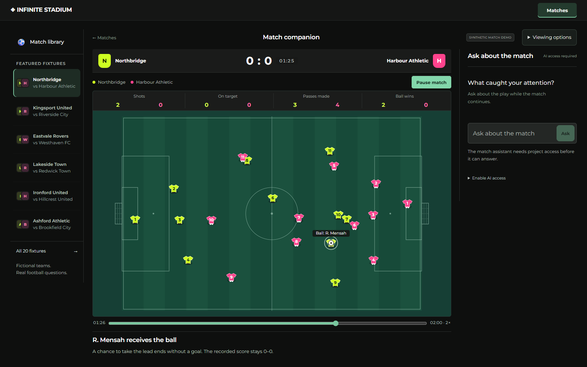

# Infinite Stadium

A football companion that answers questions about the moment you are watching while the match keeps moving.

[Watch the 118-second demo](https://youtu.be/Ay6WmVt-LIA) · [Open the app](https://infinite-stadium-lime.vercel.app/?view=watch) · [Run locally](docs/JUDGE_SETUP.md) · [Developer guide](docs/CONTRIBUTING.md) · [Architecture and deployment](docs/DEPLOYMENT.md) · [Validation](docs/VALIDATION_PLAN.md)

## Watch, ask, understand

Choose a synthetic fixture and play it. Ask a question in your own words. The assistant captures the displayed match time, queries the evidence available at that time and answers beside the replay. Playback continues during the request. Moment links let you revisit the supporting action when you choose.

The application computes supported statistics and event order. Azure AI interprets the question, selects evidence and separately reviews whether the answer covers the request. Late confirmations and corrections change what is known; future information must not leak into earlier answers.

Twenty fixtures cover five authored two-minute passage families. The schematic replay runs at a fixed 2× pace with compact statistics, timed narratives and a recap. Viewing options change the audience detail and language of subsequent supported content. English, Spanish, French and Portuguese paths are implemented; menus and some general rules remain English. This is synthetic football data with fictional teams and players, not licensed Premier League footage or video recognition.



Actual hosted Watch interface. The replay is available without signing in; live AI uses the separately supplied project access code.

## Run locally

Use Node.js 24. No package installation or credentials are needed for the synthetic replay.

```sh
node server.js
```

Open http://127.0.0.1:4173/. The server reports AI unavailability until a provider is configured. It does not label recorded content as a live model answer.

For Azure conversation, copy the placeholder settings from `.env.example` to a private `.env.azure`, configure your own deployment and run:

```sh
npm run start:azure
```

Keep credentials server-side. See [deployment](docs/DEPLOYMENT.md) for public access protection, durable usage reservations and provider continuity.

## Verify

```sh
npm test
npm run validate:data
npm run verify:release
```

The release verifier also needs Python 3.9+ and runs without model calls. Browser checks use an explicitly configured Playwright installation; the CI browser job installs its pinned runtime. See [validation](docs/VALIDATION_PLAN.md) for exact scope and limitations.

## Source map

| Area | Main files |
| --- | --- |
| Synthetic data and received state | `comparison-fixture.js`, `match-stream.js`, `stream-state.js` |
| Watch experience | `stream-ui.js`, `pitch-renderer.js`, `match-chat-ui.js`, `fan-experience.css` |
| Conversation and source checks | `match-question-ai.js`, `match-query.js`, `question-evidence-check.js`, `match-operation-proof.js` |
| Time and follow-ups | `match-chat-state.js`, `source-sequence-proof.js`, `source-context-answer.js` |
| Narratives, recaps and languages | `narratives.js`, `recap-workflow.js`, `localization.js` |
| Hosting and access | `server.js`, `vercel-handler.js`, `access-sessions.js`, `persistent-budget.js` |
| Reproducible checks | `*.test.js`, `release-check.js`, `package_judge.py`, `verify_judge_package.py` |

Tests sit beside their modules. They are retained to make behavior reviewable. Optional local-provider experiments and legacy producer modules remain for reproducibility; they are not part of the submitted Watch journey. Installed models, agent configuration, raw provider traces, videos and build snapshots are excluded from Git and the source archive.

## Evidence and practical limits

The October 22 release passed all eight local gates: 1,351 tests passed, one platform skip and zero failures. Six selected hosted Azure regression questions passed semantic checks for French follow-ups, keeper timing, independent scorer answers and Spanish shot share. Server processing took 6.0–12.3 seconds across those six cases, using two or three model calls each. These are tuned development cases, not a representative accuracy benchmark or a latency guarantee. Earlier failures remain in private development records.

An isolated browser check against the public website also verified a real French Azure answer: the question stayed pinned at 01:46 while playback continued to 02:00. The answer correctly identified the last completed pass at 01:42 and zero failed passes. That request took 12.8 seconds of server processing and three model calls. The accepted Watch UI is unchanged. Private raw traces stay local; the compact record below contains the inputs, results, scope and remaining limitations.

The October 25 deployed application passed eight local gates with 1,408 tests passed, one skip and zero failures. Four selected hosted regressions covered English shot outcomes, a French linked buildup, a Spanish team comparison and a repeated French request. Application processing took 4.658–9.251 seconds with two or three model calls. These differ from the earlier question set and do not establish a general speed improvement. The subsequent replay transfer fix was checked separately on the same first event with gzip and identity encodings. Gzip transferred approximately 31 KB instead of 225 KB and delivered that event in approximately 0.47 seconds versus 1.53–1.61 seconds in the controlled staging sample. The decoded event hashes matched. Two hosted Watch runs confirmed seeking and continued playback; a final public-site check received its first clock in 3.92 seconds and completed seeking in 0.56 seconds. These selected observations do not guarantee network performance.

The current replay-transfer and schema-module release passed all eight local gates: 1,411 tests passed, one skip and zero failures. A live Azure shot-ranking/outcome regression passed independent source checks in 8.42 seconds of server processing, using three model calls and no repairs. This fixes replay transport overhead; model generation can still take several seconds.

See [the compact evidence record](docs/EVALUATION_EVIDENCE.json), [submission status](docs/SUBMISSION.md) and [research](docs/RESEARCH.md). AI interpretation remains fallible, and unavailable intentions, pressing causes or chance quality must not be invented. The short passages do not establish a full-match player award or future winner. Azure availability depends on the configured account, quota and credit. The public source is available at [falcon-0/infinite-stadium](https://github.com/falcon-0/infinite-stadium), whose default branch is `codex/submission-release`. The approved demo is uploaded and linked on the hackathon project page; judge-access delivery and judging-period provider continuity remain unresolved.

## Build a clean source handoff

`python package_judge.py` creates an allowlisted source ZIP under ignored `artifacts/judge/`. `python verify_judge_package.py` extracts and checks it in isolation. `prepare_public_source.py` prepares a new Git-ready folder from an explicitly selected tested release; it never commits, pushes or deploys. Development snapshots and private configuration stay local.
