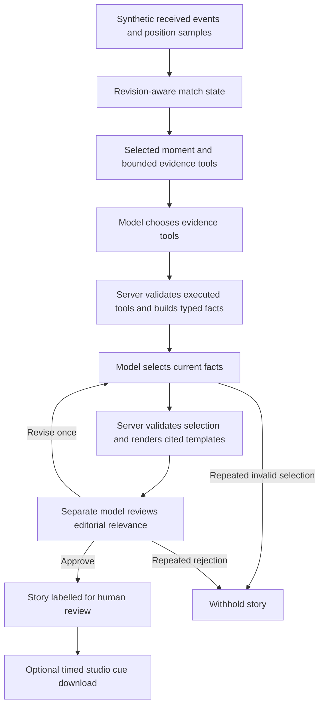

# Infinite Stadium historical development record

Archived October 7, 2026 from the complete previous root README. This document preserves the original content below without edits. It contains superseded plans, interfaces, settings, test totals and narrow development measurements; it is not the current setup guide or a readiness statement. Some original relative links reflect its former repository-root location.

Use [the current README](../README.md), [judge setup](JUDGE_SETUP.md) and [submission pack](SUBMISSION.md) for current instructions.

Original README SHA-256: `06970952bb10f59ffe6cc8202f1decabdbc3cbce3bee47841181631012606bb6`.

---

# Infinite Stadium

Local prototype for an evidence-grounded, personalized football broadcast studio.

## Current experience

The core pipeline is implemented: received synthetic events update the match state, become supported football facts, appear as stories beside the pitch, adapt to the viewer, and produce a current segment recap. Azure or local AI can investigate a moment and select supported facts; application templates supply the wording and citations. Producers can review these stories, build a rundown and preview/export the approved version. No model editorial decision replaces human approval.

The **Watch** view starts with the two-minute continuous synthetic passage. Press **Play match**, open **Key moments**, select a chance, then **Return to current moment**. Use **Personalize your view** beside the explanation to change audience or story language. The completed replay automatically displays its current recorded summary; **View recap** opens the received segment recap. **Explain this moment** and **Create AI recap** use the configured model only when requested. The separate **Studio** view contains producer review; **Developer workspace** contains fixtures, logs and independent labs.

Real fan testing is scheduled for the final stage close to submission, after product development and internal checks. The prepared tasks remain unused until actual participants attend. Final delivery still needs a fresh-computer run, a public judge-access decision, the submission recording and actual submission. Historical checkpoints below describe earlier states; the latest completed implementation is recorded at the end.

The completion guide and prepared 110-second demonstration are at the top of [the build plan](docs/VALIDATION_PLAN.md). The current regression suite passes **535 Node checks**, with one Windows symlink skip. Key moments update from the current received inventory, remove withdrawn actions, keep pending outcomes explicit, and use the selected story language. These are internal development checks. The main fan workflow and completion summary invoke no model automatically.

Live playback follows the current pitch instead of pinning it to an earlier story. Display-only animation interpolates between consecutive received samples, without extrapolating or bridging fixture resets; this animation is never used as analytical evidence. Selecting a moment or requesting its AI explanation pauses play and restores the exact evidence scene. Reduced-motion viewers see samples directly. Playback controls sit above the pitch; mobile shows the match before its explanation. The Watch view does not initialize the producer queue or its evidence requests.

The Watch and Studio workspaces use a dark purple football palette with lime and pink team accents. Watch opens with a short introduction, keeps technical context inside optional details, and moves the completion summary below the pitch to avoid displacing the match. The viewer’s active audience is visible in the personalization control. Jersey markers are reused during live updates; a persistent received-only animation clock avoids restarting each second. Named supporting players shift around the ball in the authored passage. This remains a schematic 2D replay, not video or validated football physics.

The selected-moment card now separates the action, its significance and its buildup. Received-event rules explain taking the lead, equalizing, missed opportunities and meaningful shot-pattern changes in four languages; routine actions get no invented tactical explanation. The analyst view adds two sampled measurements, while newcomer views omit them. Corrections get an Updated moment label. These instant interpretations are deterministic; the separate AI action still invokes the configured model.

Watch buildup replays received positional samples, including older highlights. It pauses the match, rejects stale selections, gaps, resets and conflicting revisions, and restores the exact selected sample when stopped. Supporting runs now include controlled carries, wider attacking shape, defensive closing, goalkeeper movement and bounded support acceleration. Authored contacts, outcomes and corrections remain explicit.

Validation for this checkpoint: 535 Node checks passed with one Windows symlink skip; desktop replay/start/stop, an older highlight, a corrected save, Spanish newcomer mode and 390px mobile layout were checked in the browser. One Azure explanation attempt timed out after the request counter moved from 8 to 10; recorded insights and replay remained usable. A non-model connectivity check reached the endpoint, but no successful cloud completion was recorded in this pass. No spending or request limits were increased.

## Run

Requires Node.js 20 or newer. No package installation or credentials needed.

```sh
npm start
```

Open http://localhost:4173. Run `npm test` for match-state and evidence checks.

## Prototype scope

The main **Match insights** screen connects a received SSE stream, a 22-player pitch and one selected story. The default Watch fixture is the two-minute continuous passage; the six-minute extended segment remains in Developer workspace. A transparent selection policy prioritizes recent shots and relevant actions; stories expire instead of keeping an old goal on screen throughout a quiet period. A selected moment displays its exact received positional sample, names the recorded participants and dims other players. Current replay time and selected scene time remain separate. Narrow screens put the match first and its explanation immediately below. Audience, language, club and player choices are under **Personalize your view**; recap and evidence details are collapsed by default. Fixture switching, corrections, event logs, agent investigation and independent labs are under **Testing tools**. No automatic model calls are made.

Selected scenes can also show up to two dashed **recorded endpoint links**: a completed pass and a shot linked to a received ball sample. These connect exact ball samples rather than reconstructing trajectories. Captions disclose each sample interval; current positions still belong to the selected event's frame. Missing, future, stale, interrupted or ambiguous links are omitted. Exact source revisions are available under Testing tools. A browser check at received 32s showed pass samples 22–24s and shot samples 28–29s beside the goal at 28s. Seeking to 28s showed only the available reception and pass link, with no unreceived shot link. Screenshot capture was unavailable; visible captions and SVG geometry were checked. Stream materialization now rejects changed contents under an unchanged tracking revision, while allowing actual newer corrections.

Reading a selected moment or requesting **Explain this moment** pauses playback. **Follow current play** returns to automatic selection. Inspection requests reuse an identical pending evidence key rather than repeatedly cancelling a slow request; changed dependencies cancel the old request, and late responses cannot replace newer evidence. Catch-up summaries show bounded highlights and distinguish new actions from delayed arrivals and corrections. A missing earlier revision makes the historical score explicitly unavailable.

**Explain this moment** invokes the canonical fact workflow on either configured provider. The model chooses evidence and facts within application rules requiring the moment and any supported goal consequence; the application owns wording and citations. Agent draft freshness includes score dependencies outside the selected moment window, so an earlier goal correction invalidates a later score-dependent draft.

While generating, the same button becomes **Cancel explanation** and the status shows elapsed time. Cancellation aborts the browser request, terminates the local worker or aborts the Azure transport, and prevents subsequent agent calls. The generation lock is released so another request can proceed. Leaving the page also cancels its generation request. An already-accepted Azure request may still incur provider usage; cancellation is not a refund or billing cap. Cancellation was verified with the actual local browser and mock Azure transport, without a new cloud model call.

**Inspect correction demo** loads the central shot at 8s. Advance the received replay time to 10s to see the corrected shot sample and measurements; rewind to restore the earlier revisions. Drafts are marked superseded when the selected moment, received evidence or preferences change. Local model and human review quality remain limitations. Live template cards are explicitly separate from AI drafts.

The earlier six-minute event-only demo and positional scene lab remain under **Open independent evidence and fixture labs**, with their own clocks. In that older event-only demo, seek to 02:49 for the first goal and 03:31 for the high-recovery story.

Commentary cards are deterministic template output. The main pitch renders received synthetic positional samples, not real player tracking. The unified extended segment ends 2–1; the older event-only segment ends 1–1. Neither represents a full match. The state engine supplies only revisions received by the replay clock to commentary.

## Judge walkthrough

Start the synthetic replay with **Play match**, or seek to received time **03:00** to inspect Harbour Athletic's equalizer at **02:58**. Current score and the selected scene's time remain distinct. Expand **Personalize your view** and choose **Player follower**, **D. Silva** and a story language. The player panel counts received actions in its labelled window; the pitch identifies the selected buildup and outlines the followed player.

With a configured model, press **Explain this moment**. Playback pauses. The model selects evidence and facts; application templates supply the wording. Open **AI evidence and execution** for exact references and measured execution, then download the studio cue for human review. Local inference may take up to three minutes; readiness and one successful check do not guarantee performance on other hardware.

Under **Testing tools**, select **Inspect correction demo**. At received time **00:08**, inspect the recorded shot sample; move to **00:10** for its correction. Measurements and story dependencies update, and any old AI result is visibly superseded. Use **Match recap** to catch up or inspect an earlier moment; inspection pauses playback. No demo action automatically invokes a model.

The canonical-recap checkpoint source extraction passed all 285 Node tests and 10 SDK mock tests. Its independently created Python environment matched all 19 locked dependency versions and had passed `pip check`. Later studio changes are verified separately. This was a separate folder on the development PC, not a different physical machine; it did not download or run a model. The source ZIP excludes credentials, installed packages and model weights.

## Latest checkpoint: fact-selected studio stories (October 6)

The main explanation button now uses a constrained fact-selection workflow on both Azure and local Microsoft Agent Framework inference. The workflow gathers required event/score foundations, lets the model choose additional evidence and current fact IDs, and uses a separate model to review editorial relevance. Application templates render the selected facts in English, Spanish, French or Portuguese with complete citations. The interface labels this authorship explicitly. Free prose remains an experimental draft path under Testing tools. Local selection uses compact numbered fact slots, and the server maps them back to canonical fact IDs before rendering. Neither model review nor canonical wording establishes source completeness, football realism or real-world truth.

Two earlier Azure spot checks exposed unsupported wording and incomplete aggregate/score citations despite model reviewer approval. Targeted safeguards were added, followed by the separate fact-selection path. One actual analyst fact-selection check at received time 180s returned five supported claims in 9.886 seconds with three model calls, four tools, no repair, 9,740 input tokens and 165 output tokens. The score included both contributing goals. These are one-case measurements, not a model accuracy estimate or evidence of comparative performance.

A new actual local canonical newcomer check at received time 32s returned three claims in **108.4 seconds**, using three model calls, two evidence tools, no repair, **1,864 input and 60 output tokens**. The goal, recovery-to-shot interval and completed-pass count retained their full reference sets. Output wording came from application templates; Qwen3 selected tools and fact slots and reviewed editorial relevance. The shared local deadline is 180 seconds with at most five worker/model calls and one repair. This is one case on this machine, not live-performance or model-accuracy evidence. Run `npm run probe:local -- --fact` only when intentional local model work is wanted. The local canonical evaluation adapter is available through `npm run evaluate -- --local --adapter=fact-selection`; ordinary offline evaluation makes no model calls.

Canonical stories can be downloaded as machine-readable studio cues from their evidence details. Cues include event time, received time, duration, exact revisions and explicit `human-review-required` status. Export rejects changed preferences and superseded references. This is a review artifact, not a production publishing integration. Catch-up retains received revision history, labels missing history as uncertain, and processes actual deletion records without inventing citations.

Deployment preparation now supports an optional project access code through an HttpOnly session cookie scoped to `/api`, with a one-hour expiry and logout. The main UI can unlock AI without saving the code in browser storage or exposing the Azure key. A disposable-code browser check confirmed unlock/lock behavior with no model calls. This does not constitute a public deployment. Session state remains in memory. The Azure request counter can now persist across restarts on the same filesystem through MODEL_BUDGET_FILE; replicas with separate files still have separate counters.

`npm run validate:data` audits four fixture kinds at three seeds. The twelve checked variants had no contract errors or configured heuristic warnings after fixing short-fixture pass endpoints. Pending endpoints stay unknown; completed endpoints match the authored reception. Checks cover revision identity, received timing, roster stability, bounds, coordinate conversion and action/sample links. Motion warnings exclude explicit resets and use adjustable thresholds. Passing these checks does not prove football realism.

The current checkpoint passed 410 Node tests (one platform-specific symlink test skipped) and fourteen mocked Python framework tests using `.venv\Scripts\python.exe`. The offline evaluation produced 13 template drafts, five correct abstentions and no template failures; model adapters were skipped. Human semantic review, independent football plausibility, external user testing, a fresh-computer installation, public hosting and judging-period continuity remain open.

## Canonical AI segment recap

The existing collapsed **Match recap** panel now has one optional **Create AI recap** action. It freezes received time and current preferences, pauses playback and gathers the full received segment rather than the selected moment's rolling window. The model chooses from typed overview, team shot totals, pass outcomes, goal score changes and favorite-player involvement; application templates render the selected facts in English, Spanish, French or Portuguese. The overview leads, and selected goal highlights stay chronological. Recorded pass percentages use only known outcomes and disclose pending attempts.

This workflow uses two model roles normally, at most four calls with one repair, and no model-selected tools. Local SDK phases use compact numeric slots; Azure selects current fact IDs. The server supplies complete citations after selection, keeping citation lists out of the editorial model context. The limits are 60 seconds on Azure and a shared 180 seconds locally. Failed selections or repeated editorial rejection withhold the AI recap. The deterministic recap remains available during failure or cancellation and returns whenever the AI recap becomes superseded by received evidence, time or preferences. No automatic cloud call runs on segment completion.

An actual local browser check at received time 362s returned a three-claim recap in **94.2 seconds**, using two model calls, **1,967 input and 38 output tokens**. Its citations were complete, but it selected the first goal and equalizer while omitting the later goal behind the recorded 2-1 score. Model editorial approval missed this coverage gap. The workflow now requires the latest supported goal change when its after-score matches the received overview; omission receives one repair and then withholding. This coverage rule does not establish source completeness or broader editorial quality.

A second actual local browser check with the coverage guard returned the overview, first goal and latest recorded lead change at 05:28. It completed in **83.5 seconds** with **three model calls, 2,939 input and 52 output tokens**. All supporting goal revisions were visible in its citations. These are two spot checks, not a controlled quality or latency comparison. The UI also confirmed that changing received time marks the old recap superseded and restores the current recorded recap.

Run `npm run evaluate:recap` for the dedicated offline report. Its independently specified cases cover pending pass outcomes, a pre-completion cutoff, whole-segment counts at a different seed, a short received pass, exact favorite-player actor coverage and empty inventory. The template run returned five drafts and one correct empty-inventory abstention with no failures. Model evaluation requires explicit `--local --adapter=fact-selection` or `--live --adapter=fact-selection`; do not run these unintentionally. Reports describe selected fact kinds, reference coverage, timing and reported tokens; human editorial and translation review remains pending.

Actual Azure recap checks exposed selection-order, capacity and editorial-context failures. Each failed run withheld the recap rather than releasing unchecked claims. The latest check used four calls in 9.7 seconds (5,090 input and 214 output tokens) and was withheld because the reviewer requested more optional context than the newcomer limit permits. The contract now fixes application-required overview and latest supported score change; remaining context is model-selected. A subsequent capacity-aware Azure check was also withheld after four calls in 9.68 seconds (5,623 input and 184 output tokens): the reviewer switched its preference from equalizer context to home shot counts. Cloud recap reliability remains unresolved; no further cloud retries were run in this stage. Scorer names are now rendered directly from the selected received goal values in all four languages.

The recap reviewer now uses the explicit **objective-player-focus-v1** policy. Factual/citation/chronology checks remain application rules. The sole blocking editorial criterion is feasible missing favorite-player coverage for a player audience; current replacement IDs and capacity are validated, and the application enforces the rule even if a model incorrectly approves omission. Equalizer-versus-shot preferences and richer context are nonblocking suggestions, preserved under the collapsed execution details. Invalid reviewer contracts still receive only one repair and then withholding. This is a deliberate selection policy, not a claim of general factual or editorial certification.

An actual Azure French newcomer check after this policy change returned three cited claims in **10.15 seconds**, with two model calls, no repair, **3,073 input and 127 output tokens**. The overview cited all 50 active received events and the latest goal cited all three score-supporting goal revisions. It also returned three optional style suggestions. This is one successful API spot check; broader model, editorial and native-language review remains pending.

An actual local player-audience browser check for D. Silva at 362s returned the overview, latest lead change and the chosen player's ten recorded actions (five shots, one goal, no passes or recoveries). It took **160.0 seconds**, four model calls and one repair, with **4,820 input and 169 output tokens**. The initial model selection omitted the player profile and its reviewer approved; the application's player-focus rule forced repair. The final profile cited its ten actor-event revisions. This is one integration check, not an accuracy estimate or acceptable live latency. One reviewer suggestion described an incorrect pre-equalizer score; editorial suggestions are now explicitly labeled unverified, stay inside collapsed execution details and never enter canonical claims or studio cues.

Viewing choices now persist in one versioned browser key containing only audience, language, favorite club and favorite player. A browser check confirmed French/D. Silva/player mode survived reload without an AI request. Reset restored defaults while preserving received time at 03:00. Storage denial falls back quietly; failed removal reports a reset for this visit instead of claiming the saved profile was removed. Player windows use match-clock notation. The 375px viewport check showed no horizontal document overflow; screenshot capture was unavailable for that check.

These are fictional segment recaps, including in-progress or short fixtures, not full-match results. A reported zero count describes the received inventory and does not establish provider completeness. The route is `POST /api/agent/recap`; authorization, process generation locking, cancellation and the Azure call budget apply to it as well.

Accepted canonical AI recaps now expose **Download recap rundown** inside their evidence details. `POST /api/studio/recap-cue` reconstructs the requested synthetic snapshot and revalidates the exact canonical claims, selected facts, whole received inventory and required latest-score/player coverage. Changed record bodies, even with unchanged IDs/revisions, fail validation. The route uses the existing authorization and origin checks, a 128 KiB body limit and no model calls or generation budget. The UI cancels exports when replay/preferences change and checks freshness again before downloading.

The JSON review artifact contains ordered segments with original event times, exact dependencies, preferences and proposed six-second relative pacing per segment. This is review pacing, not live-overlay timing or publication. It requires human review and excludes model execution traces, unverified editorial suggestions and access inputs. A clearly labeled mock-provider browser check saved a two-segment rundown with all 50 inventory references and all three supporting goal revisions. Seeking to 180s removed its export control. The browser download-event waiter timed out, but the saved JSON file was independently checked. No real model calls were made for these checks. A separate mock-provider failure check confirmed old recap errors clear after a seek.

## Minimum goal explanation

For confirmed goals, application rules supply received event and score evidence and require the supported score-change fact alongside the selected moment. The AI still returns the selected IDs or slots; missing required selections get one repair and then withholding, without silent insertion. Application-required tool reads and model-selected tools are reported separately. Simultaneous goals can make a unique score-change order unavailable; that uncertainty is disclosed without inventing a consequence. This adds no required model phase.

An actual local newcomer browser check of the equalizer at 178s returned the goal and the recorded 1-0 to 1-1 change in **97.4 seconds**, using three model calls, two evidence tools, **2,064 input and 49 output tokens**. The score-change claim cited both received goal revisions. The preview remained visible at 197s and hid every claim at its exact 198s event-age expiry, without another model call. This one-case check does not establish model accuracy, live narration latency or comparative performance. The updated Azure workflow currently has mock-provider coverage; it has not yet received a new live check.

## Studio cue consumer and event withdrawal

Under **Testing tools**, **Studio cue preview** consumes an existing canonical AI moment story without another model call. It independently fetches current server evidence for that cue, recomputes metric references and hides claims while validation is pending. Every cited revision must remain current. Changes to fixture, seed, audience, language or favorites withdraw the preview. Expiry additionally uses an explicit event-age cutoff; exporting a late correction cannot revive an expired event. Downloaded review artifacts retain their original timing. Nothing is published to a broadcast service.

An actual local browser story at 8s took 71.5 seconds with three model calls, one evidence tool, 1,274 input and 46 output tokens. It selected only the recorded goal statement, so it did not explain the goal's score significance. Its current cue displayed locally and was withdrawn at received time 10s when the goal revision changed; previewing and revalidating made no additional model calls. This is a one-case integration check, not a latency or editorial-quality benchmark.

The **Goal event withdrawal** fixture reuses the authored eight-second geometry with separate identities. At 8s the provider records a goal; at 10s it corrects its location; at 11s an actual minimal revision-3 tombstone retracts the entire shot event. Score and shot count return to zero, and the goal disappears from the recap and overlays. This is a synthetic provider withdrawal, not video analysis or an offside/VAR determination. Tracking samples and the completed pass remain recorded. No fixture control invokes an AI model automatically. A continuous browser replay verified the score returning to 0-0 and catch-up explicitly reporting the actual withdrawal at 11s. Withdrawals within the selected interval remain visible as received updates while being excluded from current action counts.

## Implemented AI moment story flow



Azure uses custom Node orchestration with the configured Foundry model. Local inference uses Microsoft Agent Framework and Ollama; its SDK invokes the selected read-only tools. The server owns fact identity, revision checks, canonical wording and citations in both paths. Editorial approval concerns relevance and presentation, not real-world truth. These story requests are separate from the continuously updating template replay; neither path publishes to a broadcast service.

## Evidence investigation demo

Click **Load goal investigation**, then **Advance to scorer correction**. At 02:49 the observed feed attributes a goal to A. Reed. At 03:10 a revision identifies J. Cole. The pinned explanation, pitch sequence, player commentary and recap update; the score stays 1–0. The earlier explanation remains explicitly marked superseded. These are deliberately simulated provider messages, not a claim that the system independently knows the real scorer.

Each event has event time, arrival time and a revision number. A recovery at 02:40 arrives at 02:44. Rewinding restores the information available then. Duplicate deliveries and obsolete revisions cannot double-count or roll back accepted events. Explanation dependencies include the full bounded event window so late insertions also invalidate old results. The integrated Goal event withdrawal fixture now exposes an actual deletion scenario; this older independent lab retains its scorer-correction example.

Evidence validation checks revision consistency, not arbitrary AI prose or real-world truth. The browser still receives the complete local fixture; the clock boundary is a correctness boundary rather than a security boundary.

## Positional scene lab

Choose a central or wide receiving run, then click **Load shot evidence** and **Receive position correction**. At 8s the shot sample places home #10 at x=82.6 m; at 10s a provider revision changes it to x=85.6 m. The nearest-opponent measurement, scene and recap update together, and the earlier recap is marked superseded. Rewind to restore the earlier evidence.

The server supplies only received events and positional samples. The fixture generator and canonical positions are not browser assets. Event, frame and derived metric references share the investigation contract used by the Azure adapter. A missing exact-time sample produces no nearest-opponent measurement. Each seeded fixture has 22 named tracks, a ball, a pass, a reception and a shot. These are separate scripted scenarios, not reconstructions of the match above or a validated football simulator. Geometry alone does not establish intent, tactical pressure or shot quality.

## Narrative and recap backend

### Integrated event and position stream

`GET /api/match?kind=central&seed=17&time=8&audience=analyst` now returns one bundle: received match state, a selected explanation, and a recap with overlay records. Use `anchorId=central-17-receive` at `time=4` to inspect the completed pass. `kind=wide` supplies the alternate seeded sequence. Observation time ranges from 0 to 12s; the scripted playing segment ends at 8s and a position correction arrives at 10s. The fixture records a synthetic goal outcome; it does not model the post-shot ball flight.

This integrated fixture has 22 player tracks and consistent player IDs, event coordinates and metre-based samples. It is available in the main browser lab, alongside the extended segment. The pass outcome is initially pending and becomes completed when the reception is received; accuracy uses known outcomes as its denominator, returning null when none are known.

Measurements include nearest-opponent distance, player displacement rate between explicit samples, and the pass's ball endpoint displacement once reception is available. Endpoint displacement is not ball path length; sampled player displacement rate is not top speed. Missing exact-time samples suppress those measurements. Each measurement has a content-addressed identity incorporating its formula, value and input revisions, so different measurements cannot keep the same citation identity after a correction.

`POST /api/ai/explain` accepts `{"source":"integrated-match","mode":"moment","kind":"central","seed":17,"time":8,"anchorId":"central-17-shot","audience":"analyst"}`. Set `mode` to `recap` to draft the received segment recap; no anchor is required in recap mode. Both paths use the shared received evidence contract. This path has mock-provider coverage; Azure inference is now privately configured, with bounded moment checks recorded below. Integrated recap generation has not yet been checked against the live model.

`GET /api/recap?time=169&audience=analyst` returns a deterministic recap of the received demo segment, selected shot/goal narratives and machine-readable overlay records. Supported audiences are `newcomer`, `analyst` and `player`; optional `favoriteClub=home|away`, `favoritePlayer` and `limit=1..10` influence selection. Goals rank above shots; recorded recovery sequences and favorites add explicit ranking bonuses. This is a transparent prototype policy, not a learned importance model.

Every narrative carries event revision references and an identity key. `recapChanges(previous, current)` returns replacement entries and withdrawals when evidence or selection changes. Corrections repair scorer text; deletions repair the score and later score context. Overlay records include event time, availability time and expiration; the prototype uses a 20-second display window and does not replay an expired goal overlay when a late correction arrives.

The Azure adapter also accepts `POST /api/ai/explain` with `{"source":"recap","time":190,"audience":"analyst"}`. It prepares a cited draft using only received evidence. This backend path is not wired into the UI yet; Tests use a mock provider, and this recap route has not been checked against the now-configured live Azure model. Reference validation does not establish semantic correctness. These outputs recap a six-minute segment, not a complete football match.

## Optional Microsoft Foundry AI

### Investigator and reviewer workflow

`POST /api/agent/investigate` accepts `{"kind":"central","seed":17,"time":8,"anchorId":"central-17-shot","audience":"analyst"}`. The investigator model chooses among five read-only tools: received event sequence, positional samples, deterministic moment measurements, the recorded score at the moment and `get_match_patterns`. The fifth tool supplies counts and recovery-before-shot sequences in the received 120-second window ending at the selected moment, with input revision references. These are bounded observations, not tactical causes or proof of pressure. The selected event and observation time are fixed by the server; model tool arguments cannot expand that scope. Only references returned by executed tools may be cited.

After citation validation, a separate model call reviews the draft against the gathered evidence. A rejection triggers at most one repair. Repeated citation or reviewer failure returns `status: "withheld"` and no claims. An accepted response is still `status: "draft"` and requires human factual review: neither citation checks nor a model reviewer guarantees truth. Investigator and reviewer currently use the same configured deployment with separate prompts and calls, not independent models or a managed Foundry Agent Service deployment.

Execution is bounded to six tool calls, eight model calls and a 60-second overall deadline, with a 30-second per-request timeout. Responses report role/tool traces, repair count, measured elapsed time and provider-reported token totals when available. These are runtime measurements, not a quoted monetary cost. This budget is an initial experiment cap, not evidence of live-play latency. The endpoint shares the draft API's local-only origin guard and concurrency limit. The main Azure explanation button invokes this workflow; a separate investigation control remains under Testing tools.

Tests use a mock provider to cover tool selection, separate review, repair, withheld output, ungathered/stale references, malformed responses and execution limits. Initial Azure connectivity and latency checks are recorded below; broad quality, reliability and any advantage over the single-call baseline remain unproven. Compare all three approaches (templates, one model call, investigator/reviewer) before making a multi-agent category claim.

Tool-calling protocol reference: [Microsoft Foundry function calling](https://learn.microsoft.com/en-us/azure/ai-services/openai/how-to/function-calling).

Under the default server configuration, the **Generate AI draft** button calls a server-side Azure v1 Chat Completions adapter. Under `npm run start:local`, it uses the local provider described below. It sends only the selected moment's received evidence window and deterministic analysis. Spatial drafts also receive positional samples, measured geometry and their revision references. Choose newcomer, analyst or spatial description. Successful drafts show citations and remain drafts requiring factual review. Validation rejects malformed output, missing citations, future/out-of-window references and outdated revisions; it cannot prove that a sentence follows from its citations. Corrections make existing drafts visibly superseded. Regeneration is manual, avoiding repeated paid calls during replay.

The Azure adapter stays off until you supply a resource endpoint, deployment supporting v1 Chat Completions, and key. Copy `.env.example` to `.env` locally and fill in those values. Never share keys in chat or place them in browser code. With Node 20.6 or newer, run:

```sh
node --env-file=.env server.js
```

Restart the server after changing settings. The status endpoint reports configuration, not verified connectivity; only a successful generation confirms a connection. Without settings, `npm start` continues to run the local templates. Tests use a mock provider; bounded real Azure checks are recorded below. Model requests time out after 30 seconds and one generation runs at a time. The default binding is localhost; public binding controls and their limitations are described below. Production secret management and deployment verification remain required.

Adapter reference: [Microsoft's Azure OpenAI v1 API documentation](https://learn.microsoft.com/en-us/azure/foundry/openai/api-version-lifecycle?tabs=key).

## Budget and local AI experiment

The ongoing cash budget is **strictly $0**. On October 5 the user approved up to **$5 of existing Azure trial credit** for connecting and testing GPT-4.1 mini, with no pay-as-you-go upgrade. That is a bounded trial experiment, not authorization for further spending. Azure inference is configured privately on the development machine; the source test build contains no credentials or account-specific settings. Azure is not required to run the deterministic prototype. A free Azure trial is not our continuity plan through November 20.

The local main story uses Microsoft Agent Framework's native Ollama provider with `qwen3:4b`. A model selects one to four bounded evidence tools; the SDK invokes their real `FunctionTool` objects with empty arguments. A separate model selects compact fact slots, and an editorial reviewer approves or requests one repair. The application supplies wording and complete citations. This is explicit orchestration rather than automatic provider function calling. The earlier free-prose workflow remains under Testing tools. Azure uses custom Node orchestration.

Install Ollama, Python 3.10 or newer and the approximately 2.5 GB model, then prepare the optional environment:

```powershell
ollama pull qwen3:4b
python -m venv .venv
.\.venv\Scripts\python.exe -m pip install -r requirements-local.txt -c requirements-local-lock.txt
npm run probe:local -- --fact
npm run start:local
```

On Windows, `powershell -File setup-local.ps1` performs the optional Python/model setup. `npm run start:local` selects local inference and loopback hosting without reading Azure configuration. The main explanation button uses `/api/agent/story`; `/api/ai/explain` and `/api/agent/investigate` retain the experimental prose paths. The status endpoint distinguishes installed Python packages, the Ollama runtime and the downloaded model; readiness does not establish semantic quality.

The worker reads a fixed received-evidence packet over stdin. It cannot request a different time, execute shell commands or browse the web. The canonical workflow shares a 180-second deadline across up to five worker/model calls, four selected evidence tools and one repair. The experimental prose worker has separate eight-call/six-tool limits. Output schemas constrain tool names, claims and review decisions; Node independently validates citations against tools actually invoked. A reviewer rejection withholds the claims. The worker uses CPU inference because this machine's NVIDIA driver rejects the installed Ollama CUDA build. These controls do not establish live-play latency. Local inference has no API charge but uses hardware, download bandwidth and electricity. Model quality requires actual evaluation and human review.

The [official rules, sections 1 and 4.8](https://github.com/microsoft/insidethegamehackathon/blob/main/OFFICIAL%20RULES.md) require access to a working website, functioning demo or test build through November 10, the end of judging. November 20 is the announcement deadline; retaining access through then is an optional continuity buffer. Judges may choose to assess only the submission materials, but that does not remove the working-project requirement. Fresh-machine setup and model performance must be verified before relying on a test-build delivery route. No always-online public AI endpoint is available yet. Microsoft Agent Framework is named in the multi-agent category, but category selection still requires a working implementation and evidence of useful coordination.

Provider reference: [Microsoft Agent Framework with Ollama](https://learn.microsoft.com/en-us/agent-framework/integrations/by-component/model-providers/ollama). GitHub Models is excluded: [GitHub's documentation](https://docs.github.com/en/github-models) reports its retirement on July 30, 2026.

## Azure connection check, October 5

A Foundry resource and default project were created by the portal's automatic onboarding. GPT-4.1 mini (version 2025-04-14) is deployed as `infinite-stadium-mini`, Global Standard, with DefaultV2 guardrails. Its initial 10,000 TPM allocation throttled the investigator workflow; allocation was increased to 50,000 TPM and positional context was reduced to received moment participants and measured opponents. The tool labels this as partial track coverage. Complete received samples still supply deterministic nearest-opponent measurements.

Private configuration is held in ignored `.env.azure`. On this development machine, `npm run start:azure` runs the app at http://127.0.0.1:4174; `npm run start:local` retains the Ollama alternative at port 4173. The Azure start command requires Node 20.6 or newer. The app is still hosted locally: these checks establish cloud model inference, not an Azure-hosted website or November 20 availability.

A real single-draft API call returned HTTP 200 in **3.629 seconds**, reporting 573 input and 137 output tokens. After the context/rate adjustment, the investigator/reviewer endpoint returned a draft in **12.200 seconds**, using three model calls, four tools, 7,199 input and 414 output tokens. The browser draft button also returned actual Azure output. Successful connectivity is not proof of football quality: the analyst prose still needs clearer interval wording, and the newcomer output exposed raw coordinates and ambiguous wording that require editorial review and later UI work. Before the adjustment, three endpoint attempts and one diagnostic attempt were throttled. These are development checks, not a controlled comparison or p95 latency result.

The two recorded successful API checks have an estimated token cost of **$0.0039904**, using Microsoft's retail API rates for Global Standard input/output ($0.0004/$0.0016 per 1K tokens). That estimate excludes the separate browser generation and successful model calls preceding throttled failures. Provider usage records and rate snapshots are kept in `artifacts/azure/`; actual Azure billing can lag. The configured twelve-call daily process limit resets on restart and is not an account spending cap. No pay-as-you-go upgrade or public app deployment was performed. Exact trial-credit expiry and a cash-free continuity route through November 20 remain unresolved. At this earlier October 5 checkpoint, 62 Node tests and two Python framework contract tests passed; the latest verification count is recorded separately below.

## Extended fixture, streaming and languages

`GET /api/match?kind=extended&seed=17&time=360&audience=analyst&language=fr` returns the main UI's six-minute integrated segment with 22 player tracks, twelve scripted phases and a final 2-1 score. Zero-based phases 2, 6 and 9 end with intercepted passes; phases 4 and 8 retain possession without a shot. The other seven phases include a delayed shot, ball-flight sample and later position/event correction. Pass outcomes begin pending and resolve from the received reception or interception. Twenty-second reset intervals connect the phases; these are explicit fixture resets rather than simulated football play.

At the completed observation horizon, the current fixture contains 50 events, seven shots and twelve passes, nine completed (75% of known pass outcomes), with a 2-1 score. It supplies 361 revision-one positional frames and seven frame corrections. Totals count current records rather than revision messages. This is reproducible scripted data, not a validated simulator or full match.

Sampled ball displacement rates require actual received launch/flight samples. They are interval measurements, not instantaneous speed, calibrated shot quality or scoring probability. Recap model context contains selected measurement input frames rather than the complete segment's tracks.

`GET /api/stream?kind=extended&seed=17&time=0&speed=12` supplies Server-Sent Events with event and position upserts, withdrawals, recap changes and timed overlay updates. Resume using a matching `Last-Event-ID`, for example `extended:17:30`. A fresh bounded position window accompanies updates; clients should discard older samples. The stream stops at the observation horizon. No model call runs on each frame.

Backend templates support `language=en|es|fr|pt` for newcomer, analyst and player narratives and recap summaries. Language preferences also reach the Azure model prompts. Native-language quality, live translation and the complete localized interface remain unverified.

## Evaluation and portable hosting

```sh
npm test
npm run evaluate
```

Offline evaluation covers eighteen cases: received, pending, revised, future and delayed evidence across central, wide and extended fixtures. AI adapters are explicitly skipped without opt-in live calls; offline success is not a model quality result. Reports under `artifacts/evaluations/` retain denominators, descriptive latency, citation/current-key checks and pending human semantic review. `npm run evaluate -- --local --smoke` compares local templates, one model call and investigator/reviewer on three cases without Azure calls. Omit `--smoke` for the eighteen-case suite; CPU runs can be slow. `npm run evaluate -- --live` invokes Azure and can incur charges; it is excluded from our $0 plan.

### Measured local results, October 5

The three-case CPU smoke comparison completed before the latest prompt compaction. Each adapter correctly abstained on the future goal. On the two answerable cases, the single-call adapter produced one draft (163 seconds) and timed out on the other (178 seconds). The investigator/reviewer produced two structurally valid drafts (34 and 134 seconds), but one simply echoed the instruction to explain the moment. Its reviewer incorrectly approved it. These are not two useful answers or evidence of multi-agent superiority. The corrected-goal measurement was spot-checked against the deterministic tool values; independent football and multilingual review remain pending.

Following that run, the worker's context was reduced, the imperative task field was removed from investigator input, and the known instruction echo is rejected. Contradictory reviewer approvals are also rejected. The narrow echo guard does not detect every unsupported or irrelevant sentence. The full model comparison has not been repeated after these changes.

The local drafter now allows up to three concise claims instead of forcing one sentence. A received-event writing brief supplies the moment, recovery interval and completed-pass context with exact supporting revisions. Newcomer/player moment requests omit coordinates, positional tracks and spatial metrics; analyst/spatial requests retain measured context. Local role investigations also use explicitly partial positional selections, matching the Azure tool compaction. A reference-coverage warning flags drafts that cite no complete buildup fact. It does not assess whether the prose is correct, covers every factual assertion, or explains the moment usefully. Maximum local output is 400 tokens; no retry or extra model call was added to the single-call path.

An earlier October 5 extended-fixture newcomer request at 30s returned three local claims in **110.264 seconds** (one model call; reported 1,072 input and 223 output tokens): the goal, a recovery eight seconds earlier, and one completed pass in that interval. The timing claim cited both events. The pass-count claim omitted its recovery boundary citation, although the recovery was cited in the preceding claim. This prompted a tighter per-claim coverage check and explicit boundary-citation guidance. A later single-case check is recorded under Latest development verification; the full baseline comparison has not been repeated. No Azure model calls were used. This result improves detail over the earlier minimal draft; it does not demonstrate lower latency or general narrative quality.

An earlier October 5 actual `POST /api/ai/explain` returned HTTP 200 in **44.675 seconds**, using one local model call (551 input and 64 output tokens reported). Its draft said Northbridge recovered possession nine seconds before A. Reed's goal. That chronology matches the supplied events, but it cited only the goal rather than also citing the recovery. Citation completeness remains a reliability gap. Drafts require factual review; CPU latency is unsuitable for immediate live narration. At that historical checkpoint, **61 Node tests and two Python framework contract tests** passed; those tests use mocked model responses and do not establish model accuracy.

Raw run records are kept locally under `artifacts/evaluations/`; they are excluded from the source ZIP. No Azure or paid API call was used for these local results.

The server supports `HOST`, `PORT` and `PUBLIC_ORIGIN`. Binding to `0.0.0.0` requires a private `APP_ACCESS_TOKEN` of at least 32 characters; generation APIs then require a Bearer token. Synthetic read endpoints remain available. `MAX_DAILY_MODEL_CALLS` limits attempted Azure requests per UTC day. Without `MODEL_BUDGET_FILE`, restarting resets the in-memory count. With it, reservations persist on the same filesystem; separate replica files still multiply the allowance. It is not an account spending cap. Token-restricted deployments can use the optional access-code session to unlock generation.

A Dockerfile is prepared for portable Node hosting, but its image has not been built or tested because the local Docker daemon is unavailable. Python, Ollama and model weights are not included in that image. No public deployment has been created.

`python package_judge.py` creates a source test-build ZIP and SHA256 checksum under `artifacts/judge/`. Packaging uses an explicit source allowlist and excludes credentials, virtual environments, downloaded models and runtime logs. The ZIP still requires Node, Python, Ollama, package installation and the model download; it is not a self-contained binary. A fresh-computer setup test remains required. Microsoft Agent Framework and the Ollama Python SDK use MIT licences; Qwen3 weights use Apache 2.0. Dependencies and weights are downloaded from their publishers rather than redistributed in the source ZIP.

The integrated backend is connected to the responsive story-and-scene UI, with correction-aware catch-up and bounded pattern evidence. Next: evaluate model reliability, football plausibility and viewer comprehension, then verify a clean judging setup. Human evaluation and production readiness remain ahead. See [research](docs/RESEARCH.md) and [validation plan](docs/VALIDATION_PLAN.md).

## Historical development verification before canonical stories

An earlier checkpoint passed **113 Node tests and three Python framework contract tests**. Framework tests use mocked model responses. Coverage includes received-state corrections, pattern counts, catch-up boundaries, pending outcomes, story expiry, exact selected scenes and inspection request races. Passing these checks does not establish model accuracy, football realism, user benefit or mobile usability.

An earlier actual English local newcomer request returned three supported claims in **105.6 seconds**, reporting **817 input and 248 output tokens** from one model call. Both available buildup facts had their full supporting references cited (2/2 reference coverage). This is one spot-checked case, not an accuracy estimate or proof of semantic validation. CPU generation remains unsuitable for immediate live narration. No new Azure model checks were made for this development verification; the October 5 Azure figures below and above are historical connectivity measurements.

Historical browser integration check, October 5: **64 Node checks passed** at that checkpoint, including materializing every received tick of the extended fixture and comparing event revisions, positions, recap entries and active overlays with the backend. Browser spot checks covered the central 8s/10s correction, Spanish analyst narratives, short-sequence playback completion and preference invalidation. One local model call through the new controls returned a valid goal citation in **93.9 seconds**, but only the minimal sentence “A. Reed scores.” This is a connectivity result, not useful explanation or live narration. No Azure model calls were made during this UI integration check. Formal mobile and user evaluation remain pending.

## Received dataset export and persistent request counter, October 6

Under **Testing tools > Synthetic dataset**, **Download received dataset** saves only revisions received at the captured replay time. The server route is `GET /api/data/synthetic?kind=extended&seed=17&observedAt=362`. The full fictional fixture contains 69 raw event revisions and 368 raw tracking revisions, resolving to 50 active events and 361 active frames. Current state references the raw records instead of duplicating tracking bodies. The export includes coordinate conventions, pass outcomes, explicit reset labels and a reproducible content hash; the hash is not signed provenance. Pending pass outcomes and endpoints remain unknown. No model call is made. Both full and partial browser downloads were parsed; the full hash was recomputed successfully. The minified full response is 867,246 bytes; the pretty browser download is 1,759,330 bytes. Football realism remains unvalidated.

Set `MODEL_BUDGET_FILE=.runtime/azure-model-budget.json` to retain the Azure request counter across server restarts. Only a direct `.runtime/NAME.json` path is accepted. Reservations are stored before provider work, including requests that later fail. Status checks do not create a ledger. The counter resets on a later UTC day and rejects a backward clock, corrupt ledger or unavailable storage. An exclusive sibling lock and atomic replacement coordinate processes sharing the same file. This is a request count, not a token, dollar, account or distributed-replica cap; it cannot reconstruct requests made before activation. Runtime files are ignored and excluded from the source ZIP. An abandoned lock blocks new requests: stop all processes using that ledger, preserve and inspect the ledger and lock, and remove only a confirmed abandoned lock before restarting. Do not reset the ledger to bypass the allowance.

This checkpoint passed 381 Node tests with one symlink test skipped because Windows denied creating its test symlink. Dataset tests cover received cutoffs, corrections, withdrawals, replay reconstruction, malformed inputs and no provider calls. Budget tests cover reservation persistence, restarts, reduced limits, storage failures, corrupt ledgers and blocking without another provider call. The Python framework source is unchanged from twelve passing mocked tests. No actual Azure or local model calls were made for this checkpoint.

A main-site keyboard check confirmed that returning from a selected moment with **Follow current play** moves focus to Play/Pause before hiding the return button. This preserves the keyboard position without adding controls.

Azure readiness now distinguishes valid configuration from an exhausted or unreadable request counter. The main controls disable new AI requests in those states while keeping recorded stories, pitch evidence, catch-up and recaps available. Generation failures with 401, 429 or 503 refresh readiness. A labeled mock-status browser check confirmed this at a received goal without model calls; focused HTTP tests cover healthy, exhausted, corrupt-counter and missing-configuration cases.

After the readiness changes, the full Node suite passed 384 checks with one Windows symlink-creation skip and no failures. Real local/Azure status endpoints remained ready after restart; these status reads make no inference call. The newly activated persistent counter reported zero reservations, which describes only requests since activation and is not total historic Azure usage.

## Held-out local analyst prompt experiment, October 6

A real Qwen3:4b/Microsoft Agent Framework check used the corrected wide fixture, seed902, observed10s, Spanish analyst mode. Before the prompt change it returned two canonical claims (goal and supported lead), in80.996 seconds using three model calls,1,770 input and57 output tokens. It chose only event and score tools. The prompt now asks analysts to inspect window patterns and spatial audiences to inspect sampled geometry, while permitting irrelevant context to be omitted. It adds no model round, schema change or forced claim.

The repeated case inspected event and pattern tools; application rules separately supplied score evidence. It again selected only goal and lead, in54.877 seconds using three calls,2,037 input and55 output tokens, no repair. Reconstructing each executed-tool catalog reproduced its claims exactly, with the corrected shot revision2 and actual SDK tool trace. This demonstrates changed evidence inspection, not richer analyst output. One run per prompt does not establish speed or quality improvement; native-language and independent football review remain open. Both runs used local inference and no Azure credit. Focused workflow checks (22) and existing SDK mocks (12) passed after the prompt edits; the preceding isolated full readiness checkpoint passed384 Node checks with one Windows symlink skip.

## Fan language and audience coverage checkpoint, October 6

Main stories, live cards and recaps now use match clocks and plain football language across four story languages. Explicit confirmed off-target, saved, blocked and on-target outcomes retain their distinct meanings. A non-goal alone does not establish any of those categories, and pending or inconsistent outcomes cannot become confirmed descriptions. Off target does not establish wide versus over the bar. The corrected D. Silva shot at118s now reads naturally as missing the target at01:58. Sampled measurements use a matching supported player name or a neutral label instead of internal roster IDs. Measurement semantics, full revisions and synthetic-data limitations remain in evidence details; translations still require native review.

Analyst and spatial workflows now gather their bounded audience foundation (patterns or measurements) and require the model to choose at least one nonredundant supported context fact when a candidate exists. Simple score repetition and an anchor-only one-shot count do not qualify. Missing context gets one repair, then withholding; neither application nor reviewer silently inserts claims. Empty candidate sets stay optional and newcomer/player rules remain unchanged. Selected SDK/model tool names and application foundation reads stay separate. Azure offers only useful sources not already read, avoiding another round just to repeat foundation evidence. This is an application coverage rule, not proof of tactical understanding or editorial quality.

A real Azure Spanish analyst check on corrected wide902 at10s returned three claims, including the supported pass count, in7.098 seconds with three model calls,7,163 input and112 output tokens. That check preceded tool-advertisement and fan-wording edits. A later actual browser check on extended17 at122s returned five natural English analyst claims for D. Silva's off-target shot, recovery chronology, completed pass, sampled opponent distance and moment score. It displayed12.2 seconds, three calls,10,633 input and134 output tokens; the shot and position references were revision2. The actual browser recap returned five claims in5.2 seconds with two calls,2,827 input and147 output tokens. Northbridge's pass line correctly showed one completed and one unsuccessful outcome (50%). These are one-case measurements, not comparative speed, football-quality or language-quality estimates.

The actual story cue and recap rundown downloaded and were parsed: five story claims and five recap segments with18 full-inventory dependencies. No additional inference was needed for export. Reviewer style suggestions remain unverified diagnostics, outside claims and exports. At the requested360px phone viewport, document and client widths both measured345px with the scrollbar, the story preceded the pitch and disclosures were closed. Screenshot capture was unavailable; geometry and text checks do not certify visual quality. The normal viewport was restored.

After generation, availability refresh preserves successful output and its ready message, while a newly exhausted counter disables further AI requests. A labeled mock-provider browser check confirmed successful outputs survive exhaustion and keyboard focus moves from the disabled recap button to its evidence summary. These checks made no model calls. The runtime counter is now also excluded from Docker build context. The preceding full suite passed410 Node checks with one Windows symlink-creation skip, and fourteen actual SDK transport mocks passed. Offline story/recap checks had no failures; all twelve fixture variants had no contract errors or configured heuristic warnings. Model, football and independent viewer quality remain unverified beyond the recorded spot checks.

### Catch-up after replay seeking

Fresh replay snapshots now include actual event revision history received by the selected time. Catch-up after seeking can count corrected shots and completed passes, reconstruct the earlier score, and report withdrawals without inventing revisions. Continuous updates retain their existing delta format. History is bounded, checked against current snapshot contents, and rejects future or conflicting records. Older packets without history retain explicit uncertainty.

Catch-up shot headlines share the main viewer's outcome wording in all four languages: off target, saved, blocked, or on target only when the recorded non-goal result supports it. Unknown results remain pending, and missing player names do not expose internal IDs. A browser check at 02:02 confirmed the preceding 30 seconds show four actions including D. Silva's corrected off-target shot at 01:58. This check invoked no AI model. Screenshot capture was unavailable, so this is a browser text/interaction check rather than visual certification.

The full regression suite passed 415 checks, with one Windows symlink-creation skip and zero failures.

## Continuous passages and producer review, October 7

Choose **Explore an example** for a two-minute, continuously sampled synthetic passage. Testing tools also offers an interrupted attack and a quiet passage. These authored scenarios have explicit shot flights, varied outcomes, possession handoffs and delayed corrections; they are not a validated football simulator or a full match. The sustained example ends with a goal confirmed after its initial pending result. No restart is invented afterward. `npm run validate:data` checks seven fixture types across three seeds; all 21 variants passed structural contracts and configured sample heuristics. Football plausibility still needs independent review. Synthetic, football-realistic data is required by [official rules section 4.7](https://github.com/microsoft/insidethegamehackathon/blob/main/OFFICIAL%20RULES.md).

The main view adds **Catch me up**, a collapsed **Match picture**, and a literal comparison of shot counts across adjacent, equal 30-second windows. Incomplete, quiet or unchanged windows produce no trend claim. Comparative AI facts independently reconstruct the full received window inventory; corrections invalidate saved investigations even when their immediate scene is unchanged. Story language labels describe the translated stories, while the surrounding controls remain English.

The collapsed **Producer review workbench** prepares a local rundown from recorded stories. It supports ordering, approval, rejection with a reason, inspection and export of current approved items. Approval binds exact event and tracking bodies, story contents and viewing preferences. Corrections or missing dependencies block affected items; changing pacing, ordering or decisions makes previous exports need replacement. Local browser storage retains bounded review history. Nothing is published. A models-disabled browser test on a separate local origin verified adding an item, saving a development-only approval, requesting a download and invalidating that export by changing pacing. The browser did not return a downloaded file path, so this interaction check does not verify the downloaded bytes. Automated checks cover the export document and persistence. These development decisions are not independent user feedback.

The combined regression checkpoint passed **480 Node tests**, with one Windows symlink-creation skip and no failures, plus **14 Python SDK transport mocks**. A subsequent JSON prompt wording fix passed all 12 focused comparison checks. `node check-setup.js` checks the replay runtime without installing dependencies or using a model. `node prepare-user-testing.js` creates anonymous tasks, blank observations and separate facilitator answers under `artifacts/user-testing`; no participant sessions have been conducted.

`node canonical-comparison-cli.js` prepares an offline comparison: all arms receive the same complete canonical catalog and application checks; AI arms are explicitly skipped without an injected transport. An actual bounded Azure check of the sustained goal used one selector call (3.36 seconds, 2,937 input / 82 output tokens) and two selector/reviewer calls (3.83 seconds, 6,410 input / 90 output tokens). Both selected the same five supported facts, including goal significance and buildup, but neither selected the new comparative shot fact. This is one fixed-order connectivity and selection check, not evidence of multi-agent advantage or viewer benefit. Two initial JSON-mode requests were rejected; explicitly requesting a JSON object resolved the rejection. All five requests were reserved in the existing shared counter without changing its 12-request daily allowance. No account upgrade was made.

Independent fan sessions, football and native-language review, setup on another person's machine, public delivery and the final submission video remain pending. Passing contracts does not certify football realism, production readiness or a winning submission.

## Review fixes checkpoint, October 7

The two-minute passages now use purposeful player waypoints and explicit ball-control, pass-flight, shot-flight, rebound, dead-ball and collection intervals. Goalkeeper distribution and goal-kick restarts have recorded causes, and receiving runs begin onside. Received samples expose current ball custody without exporting the future authored schedule. Frame-by-frame tests reject unexplained drift, orphan flight, impossible handoffs and offside starts. This is an authored synthetic example, not a validated physics simulator; independent football review remains necessary.

Changing viewing preferences preserves the current clock, score and received pitch while withholding old stories, drafts, previews and exports until the matching view is ready. Request races and failed refreshes are bounded and retryable. The example identifies its two-minute scope and completion, with replay and return controls. Catch-up leads with football outcomes rather than feed bookkeeping; analyst context appears outside the evidence disclosure.

Saved producer approvals are reconstructed independently of recommendation ranking. A story leaving the top-five list does not erase a valid approval; changes to its received evidence, comparison inventory, scene or preferences require renewed review. Correction cards show previous/current text and references and name exports requiring replacement. An existing canonical AI story can enter the same pending human-review queue without another model call. The paced preview and export use the same approved text, order and timings. Checking current evidence hides the old approved script and blocks export. These remain local review tools, not a broadcast integration.

Browser interaction checks verified rank eviction preserves approvals, preference refresh preserves clock/score/pitch and hides the previous script, and a corrected event/frame invalidates an exported approval and offers a pending replacement. A real Azure analyst explanation returned five supported claims in 9.3 seconds, using three model calls, 14,939 input and 124 output tokens. It entered the pending queue, then an explicitly labeled development approval enabled its exact-text paced preview. Model editorial approval did not approve the human queue. The shared persistent counter increased from five to eight reserved requests; its twelve-request daily limit was unchanged. This one-case check does not establish quality or latency across matches.

At a requested 360px phone viewport, document and client width both measured 345px, with example completion, replay and return controls exposed. Screenshot capture was unavailable; text, geometry and interaction checks do not certify visual quality. The normal viewport was restored afterward.

Verification passed **499 Node tests**, with one Windows symlink-creation skip and no failures, and **14 Python SDK transport mocks**. All 21 fixture variants passed structural and configured heuristic checks. The fixed-catalog offline comparison now includes two held-out passage cases: five recorded drafts and one correct abstention, with model arms explicitly skipped. Prepared user-test materials compare manual event-feed work with the producer workflow and inspect the full passage. Actual independent participants remain **zero**; no multi-agent advantage, viewer benefit, native-language approval or football-realism certification is claimed.


## October 10-12: synchronized Watch and release preparation

Watch now reconstructs the score and compact statistics at the displayed clock from received revision history, preventing a received-ahead confirmation from revealing a goal early. Rewind restores the prior state; withdrawals remove the affected count. The animation uses a small received-sample startup reserve to absorb routine delivery jitter without predicting positions or changing the fixed 2.5x pace. A regression exercises late samples and continuous advancement.

Catalogue consistency checks compare stream statistics, AI query totals and Watch reconstruction for all twenty fixtures at 160 time snapshots. Dataset validation now includes counter and duel families and every selectable fixture. The release command runs tests, dataset and catalogue checks, offline moment/recap evaluation, packaging tests, archive creation and isolated launch with no model credentials. The first cleanroom attempt timed out during an extended interruption; a subsequent packaged launch passed all checks, including 35 browser assets and SSE completion. Current authoritative results are artifacts/release/report.json.

Submission and demo documents were rewritten around the actual open-question workflow; old submission notes moved to SUBMISSION_HISTORY.md. Deployment configuration, acceptance steps and continuity limitations are explicit in DEPLOYMENT.md. Docker's Linux daemon was unavailable; no successful container launch or public hosting is claimed. No model calls, spending, account upgrade, publication or final submission occurred in this pass.

## October 12: fan review and live question reliability

Three Astra source reviews identified mobile score placement, disappearing conversation turns, hidden Watch access controls, aggregate correction notices and duplicate recap controls. Watch now keeps the score above the pitch, retains a bounded visible conversation, exposes access when needed, flags later changes within cited aggregate windows, and keeps generation/evidence tooling in Studio or Developer. The recap summary no longer embeds synthetic-data disclosures; the page retains its separate fictional-data label. CSS refinements reduce story dominance and place stats horizontally on narrower screens.

The AI can draft from complete received contribution scopes immediately or request bounded retrieval before drafting. Both paths retain evidence validation and a separate reviewer. This is two calls when evidence is sufficient and three when retrieval is needed. Player assessments are explicitly provisional, with no manufactured official award. Live checks generated early and late standout-player answers, but took approximately 23 and 20 seconds; other requests timed out or failed to connect. Fewer calls have not yet demonstrated acceptable live-viewing latency. Per-stage timing and token telemetry now support measurement. A narrow English causal assertion guard successfully blocked an unsupported forced-turnover claim; it is not general multilingual semantic proof.

The release rerun passed all eight local gates with 666 passing tests and one skip. These checks make no public-hosting, human-feedback or broad AI-quality claim. Trial-credit testing uses the shared persistent 200-call daily allowance under the user's expanded authorization; cash spending remains zero and no account upgrade occurred.


## October 13: structured answers and conversation usability

The provider now receives strict JSON schemas for answer-or-query, cited answer and editorial review. This prevents plain-text drafts from bypassing the response contract; local citation and evidence checks still apply. Nullable optional lookup fields are stripped before execution, with a regression ensuring an unused null result does not accidentally restrict a shot lookup to pending events. Unsupported causal attribution now explains the evidence limit without asking the viewer to retry missing data. Analyst and reviewer instructions reject invented full-time results in every language.

Three Astra reviews informed a compact dark match library, top statistics, smaller laptop pitch, readable player sizing when the field is letterboxed and content-sized chat turns. Visible playback speed was removed at the user's request; Watch runs at normal speed. Browser checks at 1366×768 and 360×800 found no horizontal overflow and retained statistics above the pitch. Conversation completion announces readiness, preserves a reader's scroll position, offers an explicit new-answer control and preserves history through transient seeks. Explicit cited moment links are validated before replay; asking a question does not itself inspect or stop the match. Historical-question labels distinguish the selected moment from the evidence cutoff. The isolated browser interaction test passed with mocked responses and no model calls.

All eight local release gates passed with the optional browser test enabled: 679 tests passed, one platform symlink skip, 680 total. Four targeted real Azure questions returned in 3.2–6.2 seconds using two calls each. A Spanish answer overstated a current score as final; after prompt constraints, a 6.8-second retest returned scorer and credited assist only. Fourteen calls were reserved in the persistent October 13 ledger. A visible browser question stayed pinned at 00:05 while playback advanced to 00:19; the zero-goal answer was correct but redundant. Further writing instructions target technical wording and repetition; consistent natural fan-facing prose remains unproved. This sample does not prove broad factual accuracy, multilingual quality or production availability. Public hosting, model continuity through judging, human fan testing, video publication and final submission remain outstanding.


## October 14 - live conversation verification

Expanded Azure testing exposed unsupported motives, wrong actor attribution and absent-player zero totals that editorial approval alone did not catch. Added required per-claim review coverage and a separate code-level check of extracted player/action pairs against the roster and cited records. Duplicate, missing, rejected and unexplained checks fail closed. Explicit assists use the credited assister on confirmed goal records. These checks are not a proof of arbitrary natural-language entailment: actor extraction remains model-based and qualified evaluative prose still needs quality review.

After the assist-field correction, live first-scorer and assist questions returned correct concise answers in 6.1 and 5.6 seconds (two calls each). The unrecorded-intent case was withheld rather than publishing a contradictory action claim; a helpful grounded answer for this case remains unfinished. An absent-player goal claim was blocked in the preceding run. Do not count generated responses as semantic passes: earlier runs produced incorrect approved answers. The browser scorer question at 00:00 answered correctly while playback advanced to 00:18.

Azure HTTP 429 now reports temporary provider saturation separately from the application's daily allowance. Evaluation questions are spaced 15 seconds apart by default; reservations persist, including failed calls. No cash upgrade or ledger reset occurred. Updated playback/budget documentation and normal-speed demo editing instructions. Docker remains optional; direct Node hosting is documented and public deployment is outstanding.


## October 14 - five-review development pass

Five subagents reviewed open questions, fan UX, deployment reliability, sports design references and generic player identity resolution. Implemented a charcoal/off-white/green visual theme across Watch and Studio, removed external font loading and decorative purple gradients, simplified the chat empty state, and retained team identifiers and stats above the pitch. Desktop and mobile overflow checks were performed; mobile simultaneous pitch/chat visibility remains a gap.

Conversation language changes now preserve existing turns and pending requests. New questions appear immediately with their pinned time; failures/cancellations persist without entering model history. Actual fixture changes clear unsent drafts. A dedicated CI browser job now installs pinned Playwright and requires the component test rather than silently skipping it. CI execution itself remains unverified until a repository run.

Generic query entity resolution distinguishes resolved, absent and ambiguous actor/receiver/assister names, including unique surnames. Received identities and candidates are bound into query scope evidence. Successful-pass recipients can support reception claims; failed/pending passes cannot. One optional semantic repair uses unchanged evidence and receives a fresh validation/review; no transport retries or unchecked fallback prose. Normal inference remains two/three calls, at most five with repair and sufficient allowance. Zero-temperature question requests reduce sampling variation but do not guarantee accuracy.

Live testing still finds unsupported-intent and comparative prose; stricter checks can withhold rather than answer these questions helpfully. An absent-player repair correctly identified roster absence in one spot check. Do not present the repair or five reviews as general football-question reliability. Public hosting, judging-period model access, public repository/video and independent fan feedback remain outstanding.


## October 14 - quality-question evidence improvements

Added explicit recent assessment dimensions (attempts, shots on target, completed passes and recoveries), with chance quality, pressing, possession duration and intention marked unmeasured. Named-player recent actions are retrieved generically from the question and bounded by its timestamp. Fixed a missing-name crash in extended fixtures.

Fixed review actor validation treating real teams as unknown players. Tightened the measurement guard so a later negative clause cannot license an earlier unsupported quality assertion. If an answer includes separable unsupported judgments, retained facts receive a fresh independent review and a visible data-limit notice; no unchecked fragments are published. Known antecedents are preserved when removing an earlier claim; otherwise a rewrite is required.

Live comparison testing returned the correct recent 3 attempts / 2 on target versus 0 without the unsupported better-chances verdict. A subsequent no-shot momentum run retained circulation/recovery facts rather than a dominance claim; its orphan pronoun exposed an additional issue fixed with a regression test. Why/intent explanations still require improvement; the latest answer corrected Cole's recorded passing action but retained awkward contradictory phrasing about why he did not pass. Do not count that as fully satisfactory.

Also fixed an authorized slow request upload occupying the global inference slot before its body was received. The generation lock remains enforced after parsing, and only its owning request can release it. A real HTTP regression test confirms another complete question can proceed while a partial upload waits.


### 2026-10-14 — question premise and bounded repair follow-through

- Removed the blanket repaired-answer disclaimer; evidence checks remain active.
- Added an internal structured premise check before model claims. It is not rendered or returned in fan prose.
- Repair now receives the rejected answer as well as rejection feedback. A shorter dedicated repair policy avoids reintroducing rejected causation.
- A retained claim set that still violates the local causal or measurement guard now uses the existing bounded rewrite instead of failing prematurely. No additional repair loop or budget reset was added.
- Added regression coverage for rejected-answer forwarding and unsafe retained claims. Focused question suite: 40 passing tests.
- Latest live samples: first scorer and explicit assist answered directly; the repaired turnover answer identified Cole's recovery without inventing a forcing player; the last Cole question correctly stated that Cole passed and Reed shot. Earlier candidate runs still produced failures and awkward answers; these samples do not establish general reliability. Latest CLI ledger: 195/200 calls for the UTC day, including the browser check. Preserve the ledger and remaining allowance.
- Narrow watch layout: tighter scoreboard/stats/conversation spacing and hidden redundant pre-play welcome banner. Browser check confirmed playback continued during a scoring question, with the answer pinned to 00:05 while the match reached 00:17.
- Outstanding: wider semantic evaluation, mobile simultaneous watch/chat experience, real participant validation, public deployment and trial-expiry continuity, final demo video/submission. Do not describe this iteration as submission-ready.


### 2026-10-14 — simultaneous mobile viewing and playback recovery

- Single-column Watch keeps the original pitch and stats sticky while scrolling the conversation. A compact score/clock and pause control share the original playback handler; the large scoreboard and duplicate control are hidden at this breakpoint. Desktop retains its existing layout. Short landscape/keyboard-height viewports use ordinary scrolling.
- Real-browser checks at 390x844 confirmed the pitch and composer are simultaneously visible, with no horizontal overflow. At 1366x768 the compact controls hide and original controls remain. New isolated full-app browser regression runs without Azure credentials and is required in the browser CI job.
- Browser inspection exposed a substantial clock lag after background animation throttling (displayed 00:32 versus received 01:14). PitchPlayback previously discarded elapsed time. It now preserves ordinary elapsed time and rejoins the latest received position reserve after suspension. This never extrapolates or changes match evidence. Thirteen motion tests pass, including one-second throttling and suspension recovery. The browser later showed displayed 01:56 versus received 01:57.
- The model reviewer now receives the internal premise assessment; the fan response does not expose it. Forty-one question tests pass.
- Public hosting selection remains pending. No repository publication, external upload, hosting charge or final submission was performed by this iteration.


## October 14 — judge audit and conversational evaluation

Three Astra reviewers evaluated the whole official rubric and source/report evidence. Their provisional baseline was 66/100, not an actual judging result. Public delivery and inference continuity remain unresolved, and actual fan participants remain zero.

The repeated single-initial regression now returns a local clarification, even with earlier conversation. Clarifications remain visible but no longer displace useful conversational history. The backend does not require a model-call allowance for this local response. The daily Azure guard was expanded from 200 to 500 at the user's explicit request, preserving the existing ledger and zero-cash/no-upgrade restriction.

A frozen evaluation plan binds exact source/prompt hashes and inputs to repeat runs. Baseline records preserve 18 of 24 planned attempts: 17 generated answers and one provider rate-limit failure, with six unexecuted cases. Automated complete-state review judged 15 of 17 generated answers factually acceptable, identified two unsupported causal claims, and separately identified incomplete assist citations. These are not human ratings or general accuracy measurements.

The model reviewer approved the two causal mistakes. A successful absent-player repair was attributable to the application roster check, not proof of reviewer benefit. Remediation adds an explicit requested-information check, positive unsupported-fact extraction, and a veto on contradictory approval. Repairs rewrite the whole answer rather than removing isolated claims. Subsequent test reports remain regression evidence, including failures and overly strict reviews; the same suite is no longer described as held out after tuning.

### October 14 — cross-fixture evidence and retry corrections

Eight previously unused cases covered interrupted, counter, quiet and duel passages. The frozen first run generated six answers and withheld two. Independent automated evidence review found four factual passes, one uncertain/imprecise answer, and one wrong keeper comparison among generated answers. The valid contextual-assist answer was unnecessarily withheld; the player summary used a recent subset rather than all three attempts. These are development findings, not participant results.

Remediation exposes a fuller bounded history for named players, adds typed recovery-kind and linked-shot-outcome queries, and includes complete saved-attempt collection profiles. A reviewer now extracts quantitative assertions; application checks compare them with exact complete cited query counts/groups. Model extraction remains a limitation and is not a formal proof of arbitrary prose. Repair feedback explicitly distinguishes the completed-pass citation from credited-goal evidence.

Transient-error retries now preserve the original question, timestamp, language and conversation, leave a newer draft untouched, and keep playback running. Browser integration verifies this behavior. Semantic withholding, budget limits and authentication failures do not offer a blind retry. The local full-prompt model pilot timed out after sixty seconds; local open-question inference remains experimental and is not an established continuity solution.

### October 14 — received-action semantics and quantitative answer checks

Further live regressions exposed correct facts being withheld by incomplete citations, a wrong ordinal shot sequence, internal reference IDs leaking into prose, and generic false flags being misread as unsuccessful receptions. These failures remain saved; generated output alone is not graded as a factual/usefulness pass.

The query contract now treats result as meaningful only for passes and shots. Receive, recovery and flight events expose an unknown result; filtering those actions by false returns no matches with explicit missing-result coverage. AI context omits the nonsemantic flag. Named-player history is bounded at twenty events and ordered chronologically, with count/truncation visible. Flight samples are not player contributions.

Conservative quantity checks bind number/action phrases to complete metric scopes, values and subjects; actor totals cannot authorize an unrelated individual action. Complete timeline checks catch explicit first/second/last outcome contradictions in English. General numerical football definitions stay separate from match totals. This is not complete multilingual entailment. Repair gets exact failed text and candidate citation scopes, and fan claims are rejected if they expose actual internal source IDs. A model review and bounded rewrite remain fallible; real Azure runs are recorded separately from code tests.

### October 14 — conversational regression and review efficiency

Reviewer context now projects only cited complete scopes and current records with their explicit dependencies. A stable fingerprint identifies the full source packet; application checks still use that full source. Uncited comparison summaries can challenge relevance but cannot supply citations. One comparison reduced prompt tokens from 157,096 to 115,607 across eight development questions, with other changes present; this is not a controlled latency or multi-agent benefit result.

An eight-question new-seed run produced two answers, five withheld answers and one provider timeout. Subsequent inspection and offline replay exposed overly strict request-span matching, missed numeric extraction and an absent-player false premise. Once inspected and used for fixes, those questions became regressions. The next six-question live regression produced four answers and two withholdings in 15 provider calls (97,073 prompt tokens; 3,329 completion tokens). Correct candidates included shot outcomes, a saved shot, scorer/assist and a Portuguese football definition. The level-score answer was still blocked when the model reviewer omitted quantity extraction. The absent-player rewrite correctly identified roster absence but was incorrectly classified as an unsupported action by the application. Neither successful generation nor these automated inspections constitute broad model accuracy or native-language validation.

Mentioned player names now go through the shared lineup resolver before acceptance, including arbitrary absent names. Mixed names, abbreviated references and ambiguous pronouns receive additional checks. Watch status announcements are retained for assistive technology while repeated visible guidance is reduced. Real participant feedback, public judge access and inference continuity through judging remain unverified.

### October 14 — negative claims, pending outcomes and final conversational checks

Independent source review reproduced wrong-subject and wrong-window count acceptance, numeric suffix errors, personal-pronoun ambiguity and a negative-action claim misclassified as a positive action. Conservative checks now retain entity resolution, bind subject/metric/window, preserve player initials, validate entire count expressions, and require complete zero evidence for negative actions. A pending attempt cannot prove an unqualified no-goal verdict; pending subsets cannot prove all-shot totals. These checks supplement semantic review and are not universal multilingual entailment.

Two actual browser conversations preserved their original question timestamps and kept playback moving. Both second turns failed: one provider connection error, one semantic withholding. The exact semantic failure was reproduced with its actual generated first answer, then a later live regression returned the correct Cole no-goal response after a bounded rewrite. The failed browser reports remain preserved; that targeted result does not establish a successful complete browser conversation. Source-level checks subsequently added explicit pending-outcome context and tighter single-component repairs. The next broader live run and final browser run must be assessed separately.

The daily model-call guard was raised from 500 to 600 under the existing expanded trial-credit testing authorization, with the persistent ledger preserved. Cash spending remains zero and no account upgrade was made. The last completed full release gate passed all eight local stages; new source edits require rebuilding and repeating it before delivery.

### October 14 — compact planning and comparison verification

The next twelve-case live run generated eight answers and withheld or failed four; one generated first/latest comparison was factually wrong. After a compact planning change, a repeat generated ten and failed two, but still falsely stated that a known first-shot outcome was unavailable. These are tuned regressions, not general accuracy estimates. The two full reports preserve the drafts, reviews, provider failures and source identities under artifacts/evaluations/.

The initial planner now receives bounded current context and chooses typed lookups instead of reading every contribution profile. The answer stage receives the exact requested query results first, alongside full validation context. Whole-query counts remain distinct from grouped player/team counts. A complete shot timeline cross-checks global chronology and claims that known outcomes are missing. Clock components and the English conjunction 'but' no longer become false French goal counts. Explicit lead margins use signed subtraction over complete, matching two-team evidence.

Recovery now discards a premature draft when valid queries remain, executes that plan and reviews the resulting answer. Early citation errors retain the verified absent-player resolution in repair feedback. Equivalent separate home/away counts also produce a canonical comparison scope with no extra model call. These mechanisms operate on typed evidence and output assertions; they are not a catalog of supported fan questions.

Watch roster facts retain their evidence without offering a pointless replay link. The scorecard is approximately 34 pixels shorter, secondary labels are clearer, and isolated Chrome checks verify the entire pitch/current-action headline at 1366 x 768 and 1366 x 900, plus a mobile layout 320 pixels wide without horizontal overflow. A successful complete live-browser conversation and fresh judging assessment must still be recorded after these changes; source and mock tests alone do not establish those outcomes.

### October 14 — comparison recovery and independent answer adjudication

The next five-case live regression delivered four correct, useful answers, including a correctly labelled application-rendered absent-player correction; three were model-generated. One supported pronoun follow-up was still withheld. Independent adjudication identified an insufficient citation on a correct 0–0 statement: a pending-shot scope cannot prove the confirmed score. Two previously unexecuted wordings at seed 9193 then produced correct pending-outcome and assist-credit answers without repair, taking 13.0 and 15.6 seconds. Two questions in an existing fixture family do not establish broad reliability, native-language approval or reviewer superiority.

Further checks now require explicit numeric score statements to cite complete confirmed-goal evidence. Singular recovery quantities and conservatively coordinated quantity lists share the same subject/metric checks as their plural forms. Repairs can preserve multiple necessary facts instead of dropping comparison endpoints. The compact first request now includes the existing complete goal scope, avoiding an additional retrieval round when that supplied proof already answers a score or scorer question; this is not a measured latency guarantee. Absent-player corrections retain truthful non-model-generated provenance and do not invent zero-action statistics.

Player labels render above shirts and the ball, and hover, touch focus or keyboard focus reveals player identity, team and number. Marker coordinates and received trajectories stay unchanged. Renderer colors use charcoal and green, with team jersey contrast retained. Eight isolated renderer checks passed, including required Chrome checks; this remains automated evidence, not participant validation.

### October 14 — verified operations and selector interpretation

A real two-turn browser conversation succeeded on the earlier build: Cole's team answer at 00:03 was used in the follow-up at 00:25; the clock advanced to 00:33 without either question pausing playback or changing its timestamp. The first answer needed repair and took 22 seconds; the follow-up took 7.7 seconds. A subsequent paired reviewer-boundary experiment exposed two failures: application checks withheld false pass totals after an incorrect reviewer approval, and a false first-shot absence reached publication. That experiment did not demonstrate semantic reviewer superiority. Earlier reports and the internal 68/100 mock grade remain historical evidence, not an assessment of every subsequent change.

The operation executor now computes differences and ordered endpoints from canonical pinned queries. Verified result wording is application-rendered in four languages, with truthful AI-assisted provenance; qualitative prose remains model-written. Exact player count scopes avoid the twenty-group limit, and each plan is capped at three distinct queries. Missing classification, unknown identities and future revisions cannot become zero totals. The pitch now has one keyboard Tab stop, with arrow/Home/End navigation that preserves focused player nodes through playback.

An eight-case development run returned eight answers, but independent adjudication found only six useful answers for the requested scope. Both English and French first/latest questions were silently narrowed to shots on target, despite the correct unrestricted latest shot being blocked. All seven canonical proofs were correct inside their selected scopes; that did not prove the AI selected the right scope. The sample median latency was 13.08 seconds, with a 16.20-second maximum. It is a tuned sample, not a general accuracy or availability estimate.

The next architecture separates planning from prose: an exclusive planner selects either operations or bounded queries. Restrictive operation metrics need a conservative source-backed qualifier license; unknown paraphrases retain the ordinary query path. The registry handles declared filter semantics, not a catalog of accepted questions, and does not establish universal natural-language entailment. Review schemas bind exact question components, while actor/count review cannot overwrite application-computed facts. Further live assessment must test request interpretation as well as arithmetic and citations. The development reservation allowance is now 750 with the existing ledger preserved; it is not a dollar meter, and no cash spending or account upgrade was authorized.

### October 14 — broad routing regressions and validation repair

The broader v15 sample produced three answers from eight requests; independent review found one fully correct and useful answer. An internally correct zero-shot proof was wrongly used for a left-foot pass question. Qualitative, roster and event-outcome questions were also sent to unsuitable operations. Planning now receives question, history, roster, teams, time and tool permissions before match facts. Operations are constrained by requested domain, subjects and window; arbitrary latest-event filtering is rejected. The v16 repetition produced seven answers, with five fully correct/useful, two partial or mixed and one withheld. These are inspected development regressions, not held-out accuracy estimates.

The v17 repetition produced five answers and three withholdings. A correct pass-accuracy operation and approving review were withheld because the reviewer corrupted a number while copying the answer into its coverage quotation. A correct footed pass was rejected because the attribute guard included the recipient in a passive agent phrase. Standout counts also exposed an output parser distinction between total shots and shots on target. Those protocol and guard repairs require another frozen live run. One generated explanation still inferred non-possession from an absent pass; no reliability improvement is claimed merely from generation counts.

Pass accuracy now has a server-computed ratio: completed divided by completed plus failed, with pending outcomes separate. Zero settled passes produce no percentage; unknown classifications fail closed. Four-language facts retain exact numerator, denominator, received window and citations. The v17 pure executor passed 19 tests and the full local release passed all eight gates with 868 passed tests and one optional skip. An earlier v16 release attempt failed a persistent-budget test; the focused eight tests and subsequent full run passed, but no root-cause repair is claimed for that isolated filesystem failure.

The development allowance was expanded again to 900 calls under the user's existing trial-credit testing authorization. The reservation ledger remains intact. This setting is not a dollar-cost meter; cash spending and a pay-as-you-go upgrade remain unauthorized. The friend's separately authorized trial is still inactive, and public judge access remains unsecured.


## October 14: v20 remediation and reproducible package inputs

The v19 wide sample produced six independently reviewed useful/correct answers from eight requests, but a separate rules sample delivered an incorrect exclusive handball condition. Knowledge citation types and conditional-rule review therefore required further work; a sourced reference alone was not sufficient.

Development also found that the operation tests loaded an ignored evaluation artifact. The thirteen authored acceptance cases now live in an explicitly packaged `test-fixtures/semantic-obligations-acceptance-v1.json`, with their non-human, non-live-test provenance retained. Unused raw snapshots were not copied. The package includes `docs/EVALUATION_EVIDENCE.json`, a selected historical audit with failures and build fingerprints. Neither addition certifies later source changes. Packaging regression checks passed nine tests; the operation suite passed nineteen. Final archive rebuild and extracted-suite verification remain required.

Pass-completion answers now omit a zero-pending clause while preserving the denominator and any genuinely pending outcomes. A conservative numeric-citation completion helper is being integrated with unchanged-wording checks and adversarial tests. A follow-up audit found unsupported temporal qualifiers could be treated as whole-window counts; this is being repaired before the next source freeze and live evaluation.


## October 14: v21 release and remaining live failures

The v21 release passed eight local gates: 909 tests, 908 passed and one optional skip. The actual source ZIP was separately extracted and ran 83 Node test files with 904 passes and five environment/platform skips; no model calls occurred. This closes the ignored-fixture packaging defect, without claiming second-computer or participant validation.

Budget persistence was hardened with owned-handle closure and bounded retries for sharing errors, retaining ownership checks and existing usage. The original intermittent 503 was not reproduced in diagnostic stress runs; its exact cause is not established. Fault-injection and concurrent-process tests cover the implemented safeguards.

Live v21 rules produced four fully correct/useful answers, one incomplete selection and one incorrect pass-outcome statement. The pending-goal/ambiguity holdout delivered no answers before provider rate limiting ended the run: two withheld answers, one provider failure, four unexecuted. Provider rate limiting is separate from remaining trial credit and daily allowance. Future evaluation starts are spaced farther apart. Canonical rule statements are application-rendered English facts selected by AI, with separate provenance and truthful language metadata. General rules translation is not validated; other match-conversation language paths remain separate.

The next remediation binds bare ambiguous surnames before model expansion, derives pass outcomes from typed result fields, proves omitted review-count annotations against cited scopes, and compacts duplicate transport evidence without changing internal validation data. The release report now records the runtime source fingerprint and rejects a runtime change during its checks.

## October 14: canonical facts and composition failures

The v22 seven-request holdout delivered three useful substantive answers and one appropriate surname clarification; three requests were withheld. Spacing evaluation cases by 60 seconds avoided the earlier provider rate limit in this run. Median latency remained 12.8 seconds; slower pacing between test cases is not an improvement to user response latency.

The v23 writer selects application-proved match facts and separately authors interpretations. Review receives indexed numeric assertions rather than asking the model to recopy numeric text. App-rendered facts carry distinct provenance, and model review still checks their relevance to the actual question. Local release checks passed eight gates, with 943 passes and one optional skip out of 944 tests. These checks are not an AI accuracy benchmark.

The v23 live holdout again generated four of seven interactions. Pending-goal and danger answers selected correct facts then added excessive or redundant prose; independent adjudication found the withheld last-pass answer had an explicit pass-to-recovery source link that the model reviewer overlooked. The forthcoming v24 changes use mutually exclusive composition modes and dedicated fact-selection instructions, and prevent default full-list ordering from generating unrequested first-event facts. The live failures remain preserved in live-chat-2026-10-15T00-11-43-795Z.json. No public hosting, judging-period model continuity or human fan sessions have been completed.

The actual v23 source ZIP was extracted and ran 85 test files: 939 passes and five environment/platform skips, with no model calls. That archive predates the v24 edits. A live project-tab inspection also exposed opening possession incorrectly displayed as a ball win. Watch totals now exclude `segment-start` records from recoveries; the comparison cache includes the recovery classification, and replay-time tests cover a later correction of that classification. Raw event records remain unchanged.

## October 14: v24 semantic results and v25 measurement contract

The v24 repeated seven-case cloud set delivered seven responses. Independent adjudication found five fully useful substantive answers, one appropriate clarification and one partial assessment: the player comparison returned correct statistics without the requested judgment. Median latency was 10.805 seconds. Reported prompt usage fell from 152,435 tokens in v23 to 122,747 in v24 across the same twenty calls; this is an execution comparison, not billing confirmation or a causal latency estimate.

Five newly authored questions with changed player names then exposed broader gaps: three fully useful answers, one response about a reception instead of the requested possession recovery, and one withheld known-shooter/unavailable-speed answer. The wrong recovery lookup also used the observation cutoff instead of the requested event as the relative-time anchor. True adjacent facts did not satisfy the original question. Both audits preserve those failures.

The v25 implementation shares explicit ball-win classification across queries, canonical facts, optimized comparisons, fan statistics and moment copy. Starting possession is excluded. Unknown classifications remain incomplete coverage, not a proved zero or an inferred win. Authored interceptions now include the missing classification at their source. Raw provider recovery records remain separately queryable. Exclusive event-time bounds support dependent lookups after or before a known event; numeric bounds and current revisions are part of the query proof. Four-language canonical wording and response-form checks were improved.

The frozen v25 release passed eight gates: 975 passes and one optional skip out of 976 tests. Its actual extracted ZIP ran 86 test files with 971 passes and five environment/platform skips. The subsequent five-case cloud run delivered four responses, including the known shooter plus unavailable speed. Its recovery answer selected correct facts but was withheld because the new temporal guard required one specific lookup path. An exact offline replay confirmed that structural overrefusal; a positive-record witness proof is being implemented without weakening absence requirements. Some delivered answers also repeat source facts. These remain development results, not submission certification.

## October 14: v26 evidence and v27 viewing integration

The v26 release passed all eight local gates: 984 passes and one optional/platform skip out of 985 tests. The actual extracted archive ran 86 files with 980 passes and five environment/platform skips. These checks exclude cloud availability and public delivery.

Its five-case live novel regression returned five answers. Independent automated evidence review found four fully useful responses and one partial speed response containing an unrelated pass and repeated wording. v27 coverage-based pruning removes canonical observations unused by the approved request coverage while retaining dependencies and remapping audits. Saved-output replay returns all five responses and removes that unrelated pass; repeated wording inside an interpretation is not rewritten by deterministic text heuristics. This is offline replay, not a new live result.

Watch now restores saved viewing choices through a collapsed Viewing options drawer, offers the full received 22-player roster, and sends a bounded viewer profile with questions. Explicit question scope overrides favourites. Actual Chrome tests cover persistence without URL hints, cancelled staged choices, an inactive roster player's known zero-action profile, no AI POSTs, and mobile composer geometry after playback and Apply. A legacy narrative whitelist initially broke nonlegacy player selection; shared bounded-name validation fixes it. Mobile player context was compacted after the test caught an 8-pixel composer overflow.

The first unfamiliar profile setup still failed: the model resolved E. Khan correctly but selected completed passes twice when asked for the latest pass recipient. Two calls took 8.463 seconds; no follow-up history was fabricated. The generic pass planning/recipient contract is being corrected. A further recap audit found stale names treated as zero-action participants, legacy club labels, and starting control counted as recovery; these defects are being corrected before the next source freeze.


## October 14 wrap-up: v29 evidence, v30 contract fix and 2× rehearsal

The owner asked to wrap up and reduce token use. The v29 combined run was stopped between cases after all six fresh cases and one regression; five planned regressions were not executed. Only the pending-pass response was delivered, correctly but repetitively; the other six requests were withheld. Thirty-one model calls and all saved results are retained. Exact replay traced composition/measurement-flag mismatches separately from protective numeric-scope vetoes and the unresolved hidden temporal-anchor requirement.

The minimal v30 fix distinguishes requested missing measurements from ordinary assessment uncertainty and permits a semantically reviewed qualification in the allowed interpretation paragraph. It restores the grounded break assessment in offline replay; other documented availability failures remain. Focused main tests passed160/160 without further model calls.

At the owner's request, Watch now uses fixed labelled2× playback with no speed picker. Context duration scales with rate, giving eight wall-clock seconds at2×. Sixteen focused pacing/browser checks passed. The final eight-stage local release ran1,028 tests:1,027 passed and one optional/platform skip. A silent real-browser rehearsal recorded the full passage in60.718 seconds, applying A.Reed focus and opening the recap, with zero API POSTs/model calls and no page errors. It is visual preparation, not a final AI demonstration or public submission video.


## October 15: focused v31 answer fix and genuine Watch capture

Explicit received shot/pass-to-collection links can now prove a relative answer without requiring a redundant displayed anchor sentence. Reviewer-selected link indices are constrained to current source records. Current revisions, strict chronology, canonical recovery facts and requested team/player identity remain mandatory. This proves sequence only, not causation, counts, absence or first/next order. Coverage pruning preserves internal anchors.

The previously withheld Spanish collection request now returns F. Eriksen at 01:31 in three Azure calls, but adds an unnecessary nearby pending pass. This confirms the concrete fix, not broad answer-quality completion. Two browser comparison turns passed with original time pins, actual prior-answer context and uninterrupted playback. Those four calls took about 9–10 seconds per answer. Total focused live work: seven calls.

All eight v31 local release gates passed: 1,033 passes, one optional/platform skip, 1,034 total. The 71.04-second captioned Watch MP4 preserves actual answers and waits. It shows questions, follow-up and recap, is not published and does not cover the full Studio walkthrough. Remaining qualitative-answer gaps, public delivery and Azure continuity still prevent a submission-ready claim.

Visual QA exposed an over-broad historical-scope notice: ordinary later events inside a full-passage query window could mark a pinned answer changed. The notification now clips to answer.observedAt while still detecting late arrivals and revisions inside that earlier window. All 23 chat-state tests passed. The video predates this small notice fix and retains its original UI.


## October 15: v32 answer guards, score correction and Studio demo

Negated measurement lists remain qualifications rather than positive pressure claims; a new positive clause still fails. A whole-match assessment can no longer rely on a restricted-window metric without matching full-window evidence for that same query predicate and subject. Focused source tests cover contrasting windows, actors and exclusive endpoints. The model received the same consistent-window requirement.

The first two live checks exposed a bad keeper assessment based on recent parity and a withheld false-score correction. The added window guard then withheld that keeper answer instead of delivering the unsupported overall conclusion. Useful keeper assessment remains unresolved. Complete current team goal counts can now directly correct a score premise without requiring a redundant model-written numeric paragraph. This remains subject to semantic relevance review and exact application proofs; other contradicted premises still require explicit correction. A subsequent real Azure score check returned Dunford 1, Bracken 0 in three calls. Sixteen model calls were used across these four targeted requests; no broad live test sweep was run.

Studio's actual recorded-fact workflow passed five checks: graphic withdrawn on correction, replacement review required, earlier consent cleared, saved outcome shown after reapproval, and zero inference calls. The combined Watch/Studio MP4 lasts 94.08 seconds. It is silent/captioned and not published. Studio approval was an automated local demonstration, not evidence of human review. The retained Watch footage predates the historical-scope notice fix.

An intermediate release check detected source drift during final guard tightening and correctly refused to certify the build. It was superseded by a fresh validation of the frozen source; see the final v32 release report.

Final frozen-source v32 validation passed all eight local gates: 1,037 passed, one optional/platform skip, 1,038 tests total; runtime source remained unchanged. The archive was refreshed after documentation updates and checked in an isolated extraction without cloud inference.

## October 15: source-bound answer repair (v33–v44)

Added complete team shots-on-target scopes, canonical opposing shots-faced comparisons, requested answer forms and a smaller writer packet. Ordered final-pass questions now carry an executed strictly-before lookup tied to the current shot revision. Live v39 keeper and provisional player assessments succeeded; v41 final-pass lookup succeeded in three calls. Shot-choice runs v41–v43 were withheld for unsupported numerical or mental-state prose; v44 adds bounded repair guidance and exact-span mental-state variants, with 236 focused checks passing. The first v44 live attempt had a connection failure before generation. These are development regressions, not an independent held-out quality score. The current account remains in use; no friend-account cutover occurred. The optional local qwen3:4b download was removed at the user’s request; Azure inference is unchanged.

## October 15: final local checkpoint (v46)

Player-reference routing now works across unfamiliar action paraphrases. A timed action repeated inside a limitation can be omitted before independent review, with its original text retained in an unverified normalization audit. Natural final-pass wording requires the current executed relation and keeps its ordering proof. Both targeted Azure intention questions returned specific unknown-reason statements (eight calls, 32.7–35.3 seconds); the developer source audit notes ambiguous preceding-action wording and unnecessary zero-pass detail. Earlier provider failures and rejected answers remain available. All eight local release gates passed with 1,055 tests passed and one optional/platform skip. These checks do not certify public judging access, human usefulness or arbitrary-question reliability.

## October 15: language verification (v47)

On the existing project tab, applying Spanish changed match statistics and a real Azure answer to an English score question returned Spanish. All four statistic languages, saved settings and unchanged replay timestamps passed browser checks. Existing chat tests verify old answers retain their language and new requests use the selected language. Added concise preference help, accented translated labels and the statistics language attribute for screen readers. Menus and curated general-rule references remain English. The user’s English preference was restored after testing. Thirteen focused checks and all eight local release gates passed (1,055 tests passed, one optional/platform skip). Current Azure ledger: 264 calls; no account switch.

## October 15: answer quality and latency (v48–v51)

Added capability-limitation facts in four languages only when trusted schema capabilities explicitly mark intentions and perceived passing lanes unavailable. These are distinct from action observations and cannot support an interpretation. The planner classifies explanation targets; an unrecorded decision rationale uses a typed known-limitation selection with the actual event, preventing redundant statistics or invented prose. Independent review remains mandatory. One bounded repair can still correct a false premise or missing component.

v48 failed both live attempts and v49 still produced a verbose second answer; both remain in the development audit. The final v50 live pair returned identical concise saved-shot plus unknown-reason answers in 16.432 and 15.815 seconds, three calls each. The exact v46 input pair took 35.276 and 32.651 seconds, four calls each. Total input tokens fell from 76,158 to 45,865. Network/provider conditions differ; two tuned cases do not establish general reliability or speed. v51 changes only repair compatibility; both successful live traces replay identically offline on final source, and a false-premise correction regression passes. All eight final release gates passed with 1,059 tests passed and one optional/platform skip. Current Azure ledger: 284 calls.

## October 15: focused fan-question closure (v52–v55)

Added separate player/attacking assessment intent, a one-contribution provisional player pick, unique source-proved scorer/assist selections, and explicit-link traversal from recovery through passes to the goal. Fast factual selections still undergo independent model review. Goal-filter aliases preserve ordered proofs; strict assist fallback checks whole-match goal inventory and the actual conversation referent. Unavailable-data denials no longer trip the positive-measurement guard.

v52 exposed a team statistic answering a player question, a verbose pressure answer and an incomplete buildup. v53 corrected the player subject but withheld pressure; v54 fixed concise player and buildup selection while pressure still expanded after a false reviewer requirement. v55 clarifies that a qualified shooting comparison answers an informal attacking assessment without asserting measured pressing. No evidence guard was relaxed.

Final developer-audited Azure results: scorer 11.096s/2 calls; assist 10.289s/2; provisional player 16.788s/3; linked buildup 10.848s/2; genuine follow-up 12.673s/3; pressure retest 21.951s/3. The first five are v54 and the targeted pressure retest is v55; this tuned sample is not held out, and provider conditions vary. Prior failures remain preserved. All eight v55 release gates passed: 1,070 tests passed, one optional/platform skip. Current account ledger340; no account switch.

## October 15: four further fan-question regressions (v56–v61)

Tested goalkeeper involvement, an individual player's passing accuracy, the latest left-foot shot and a false penalty premise on sustained seed1048 at118. Preserved the initial unsupported typical-keeper comparison, repeated facts, withheld corrections and transport failures. Added a player-performance intent distinct from best-player selection, explicit saved-shot collection counts and a confirmed-outcome passing profile. Pending outcomes are excluded from the completion denominator and the wording states that boundary. Ordered facts subsume only matching event revisions and explicitly rendered attributes; an equal saved-shot subset can omit a redundant ball-win total for the same person/window.

False-action correction now selects a complete zero-action proof and uses application wording. Independent relevance/support review remains mandatory. A real reviewer incorrectly extracted a negated action as a positive action; typed application corrections now use their proved zero-count semantics while model-authored prose retains actor checks. Replaying that actual trace offline verifies the corrected behavior, and a final Azure run returned the short correction in22.380seconds/3calls.

Developer-audited final answers: goalkeeper32.947seconds/3calls (save1; team faced2on-target; provisional activity judgment), accuracy32.523seconds/3calls (Cole100%,5of5confirmed outcomes), left-foot21.526seconds/5calls (Reed saved01:36, once), false premise22.380seconds/3calls (Cole0shots; did not take that shot). These tuned inputs span consecutive builds and are not a held-out score or latency guarantee. No account switch or automatic network retry was added. Current Azure ledger397.


## October15: two-call fact selection (v62)

Individual passing accuracy now uses a unique source-proved profile directly only with metric permission, one resolved subject and the exact completed/failed partition scopes. Two facets of one attribute-filtered endpoint can use one ordered proof. Independent review still checks every question component. The same two Azure inputs returned unchanged correct answers in13.563seconds/2calls and10.431seconds/2calls, versus32.523seconds/3calls and21.526seconds/5calls before. This is a tuned two-case comparison with varying network conditions, not a general speed guarantee. All eight release gates passed:1,079 tests, one optional/platform skip. The UTC daily allowance rolled over naturally during testing; no ledger reset was performed.
